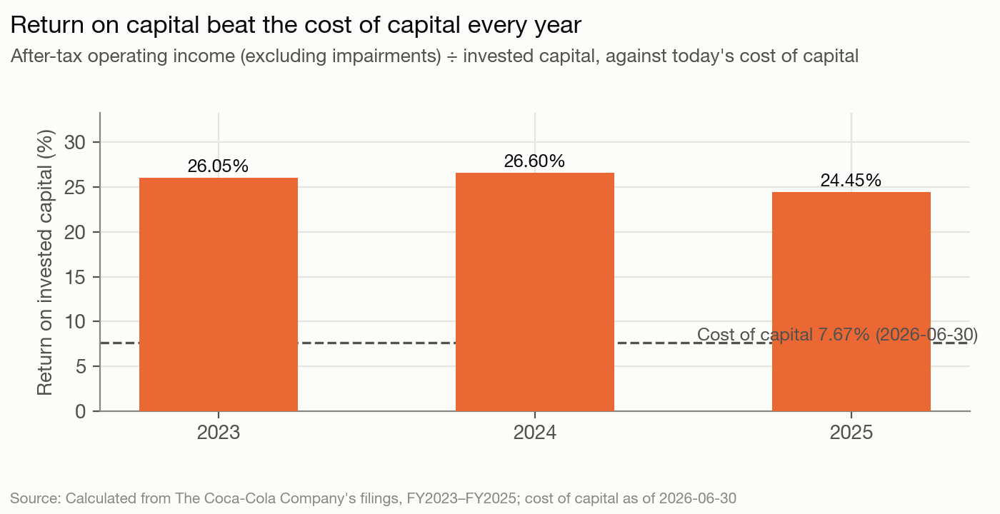
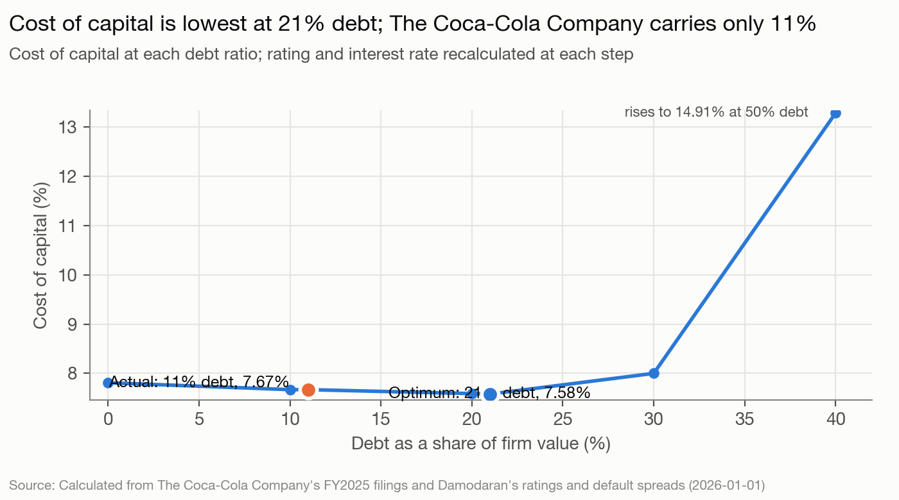
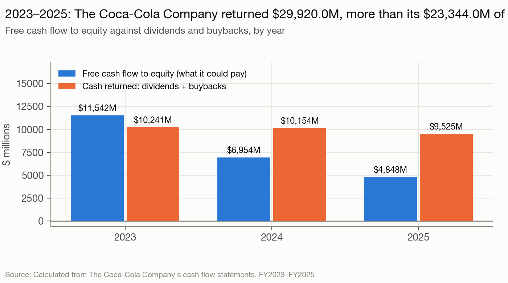

# The Coca-Cola Company — The read, as of 2026-06-30

Coca-Cola (KO) sells beverage concentrate and brands worldwide. No holder controls it: management and a 10-of-12 independent board run it, and Berkshire Hathaway (9.29%), Vanguard (8.61%) and BlackRock (7.28%; both per 2023 13Gs) are the largest holders. Analysis date 2026-06-30. This is a blind run: nothing published after that date was used, except where the last section says otherwise.

## The read

Coca-Cola is a mature, very high-return franchise: return on capital of 24%–27% against a 7.67% cost of capital. It is run for a dividend that rises every year. By the course's measures it shows few gaps between what it says and what it does. It carries half the debt the course says it should (11% against a 21% optimum). But the cost-of-capital curve is so flat that the shortfall is worth only $0.22 to $2.12 a share. Its 2024–2025 payouts exceeded free cash flow to equity only because of two one-off $6 billion payments. The one live tension is the tax appeal for 2007–2009 at the Eleventh Circuit, which sets the method for up to $14 billion of later years. We infer, at low confidence only, that management is holding its balance sheet in reserve until the Eleventh Circuit rules. The scored predictions are the watch items below. On our discount rate the stock looks overpriced ($56.79 against $81.27); with the mature-market premium and a stable beta of 0.7, value is $79.83, about the price.

## Signals

| Signal | What it says | What it does | Gap |
|---|---|---|---|
| Control | Independent board, lead director, pay at the midpoints of a 4%–6% revenue, 6%–8% operating income plan | No controlling holder; insiders 0.90%; orderly CEO handover to Henrique Braun on 2026-03-31 with Quincey as executive chairman; CFO's remit cut in January, then North America added on an interim basis from 2026-08-01 | small |
| Life cycle | "Shaping a portfolio of loved brands", 32 billion-dollar brands, half acquired | Reported revenue +2.36% a year 2023–2025; reinvestment 28.3% of after-tax operating income in a normal year; selling bottlers (India, Philippines, Nigeria, Africa) | small |
| Hurdle | No hurdle rate disclosed; pay uses revenue, EPS and free cash flow, no return measure | Cost of capital 7.67% (beta 0.63, ERP 6.30% weighted by region) | none |
| Returns | "Consumer-centric acquisitions" as a capital-allocation priority | Core ROIC 24.45% (2025) against 7.67%; but BodyArmor written down $1,720M in two years and fairlife cost a $6,173M earn-out | small |
| Leverage | Debt "we consider prudent" by coverage and debt to capital; A+/A1 | 10.87% debt ratio against a 21% optimum (APV: 24%); $39.7B below; a 30% fall in operating income still leaves the optimum at 14% | large in debt, small in value |
| Debt design | Active mix of short and long, fixed and floating | Long fixed notes to 2093, 35% in euros, ~11-year maturity, no covenants | none |
| Payout | Grow the dividend; buy back "excess cash"; 2026 buybacks only to offset dilution | Returned $29,920M vs FCFE $23,344M (2023–2025); buybacks fell from $2,289M to $746M; gap paid by $7,482M of divestitures and $1,338M of a minority-stake sale; net new debt $2,528M in 2024 and $13M in 2025; without the two one-off payments FCFE was about $35.4B | small once normalized |
| Value vs. price | Plan: 5% revenue, 7% operating income | DCF on the plan $56.79 vs $81.27; peer multiples $28–$46; P/E-based about $68 | large, but rate-driven |

**Leverage.** The cost-of-capital curve is flat: 7.67% at 11% debt and 7.58% at 21%, so moving adds $0.22 (DCF) to $2.12 (capitalized) a share (sections 3, 6). The optimum is robust: 21% on EBIT, 22% on EBITDA, 24% by adjusted present value, and still 14% after a 30% fall in operating income (`model-output.md` sections 3, 4, 9). Under-leverage is common, since meetup 3 put 80% of companies below their optimum. So the gap alone is not a finding. The 10-K says borrowing capacity is how the company would absorb an adverse tax ruling (10-K line 1328), and that liability for 2010–2025 could reach $14 billion beyond the $6.0 billion already deposited for 2007–2009 (`facts.irs-potential-liability-2010-2025`, `facts.irs-tax-litigation-deposit`).

**Payout.** The two one-off payments explain the FCFE shortfall: the 2024 IRS deposit and the 2025 fairlife earn-out. Without them FCFE would have been about $35.4 billion against $29,920M returned (`model-output.md` section 5). It filled the gap with $2,528M of net new debt in 2024 and with asset sales in 2025 (net new debt $13M), protected the dividend, and cut buybacks (`company.history`, `facts.divestiture-proceeds-2023-2025`). Normalized, payouts ran at about 84% of FCFE, so the gap is small.

**Value vs. price.** The gap does not need a story about a sale or a turnaround. It comes from the discount rate. With the mature-market premium alone, value is $73.09; add a stable beta of 0.7 and it is $79.83 (`alternatives/`). The tax stress case in section 6 ($45.66) assumes a permanent 4-point margin cut. That is far larger than the one-off $14B exposure, about $3.25 a share, so it bounds the downside rather than measuring it.

## Unstated goals

The signals show few gaps, and the skeptic pass cut two of three draft goals (see the README corrections log). What remains is low confidence and is not a scored prediction.

**Management and the board are keeping the A+/A1 rating, and leaving borrowing capacity unused, as a reserve against the tax appeal. They will not raise buybacks materially until the Eleventh Circuit rules.** Confidence: low.
- Evidence: leverage: 10.87% debt against a 21% optimum (sections 1, 3), and the 10-K names borrowing capacity as how it would absorb an adverse outcome (10-K line 1328). Payout: buybacks fell from $2,289M (2023) to $746M (2025), and the 2026 plan only offsets dilution (10-K line 1324). In 2025 the payout gap was filled by asset sales with net new debt of $13M (section 5).
- Would be wrong if: before any Eleventh Circuit ruling, repurchases exceed $1.5B in any quarter of the window (10-Qs and the FY2026 10-K). If no ruling arrives by 2027-06-30, the goal is untested.
- Rival reading: as strong or stronger. The cost-of-capital curve is flat, so staying at A+ costs about $0.22 to $2.12 a share. Coca-Cola borrowed $2,528M net in 2024, the year it paid the deposit. The buyback cut is explained by about $12B of one-off payments. Coca-Cola has run below its optimum for decades, and the agencies count bottler debt (10-K line 1391).

**Refranchising continues, and payouts stay within normalized free cash flow plus sale proceeds.** Confidence: low; mostly a stated strategy ("optimizing the Coca-Cola ecosystem", proxy line 430), recorded so the scorer can see it was considered.
- Evidence: payout (section 5) and life cycle (African bottlers held for sale, `facts.africa-bottling-held-for-sale-assets`; Coke Consolidated stake sold, `facts.coke-consolidated-stake-sale`).
- Would be wrong if: Coca-Cola buys a bottler or makes a debt-funded acquisition above $5B before 2027-06-30.
- Rival reading: the same facts are the stated strategy; invested capital grew 21% over 2023–2025 (section 8), so this is not shrinking.

A third draft goal (the CFO as a caretaker in North America ahead of a CFO change) was cut: it rested on one signal. The leadership facts move to watch item 5.

## What to watch

1. **Eleventh Circuit ruling on the 2007–2009 tax case (any date 2026-07-01 to 2027-06-30; briefing closed 2025-08-27; a ruling inside the window is itself uncertain).** A win, which the Eighth Circuit's 3M reversal of 2025-10-01 makes more likely (10-K line 1326, `facts.eighth-circuit-3m-reversal`), returns the $6.0B deposit plus interest. Expect repurchases above $1.5B in a quarter, or a new authorization, within two quarters of the ruling (medium). A loss is not final, since rehearing and certiorari remain. If a payment demand for later years follows inside the window, expect new borrowing and a negative rating outlook (medium-low).
2. **African bottling sale to CCHBC closes and deconsolidates by 2026-12-31** (stated in Note 2). Expect it to close in the window (medium-high).
3. **Dividend at the February 2027 board meeting.** Expect a 65th straight increase, to about $2.20 a share (3%–5%) (high). A freeze would overturn the read.
4. **2026 buybacks and authorizations (10-Qs July and October 2026, 10-K February 2027).** Expect 2026 repurchases near the dilution offset, under $2B for the year, and no new authorization of 2% or more of market value before the tax ruling (medium).
5. **Results and leadership: Q2 2026 results (8-K item 2.02, late July 2026), Q3 (October 2026), and the 2027 proxy (March 2027).** Expect no full-year guidance cut, given the currency tailwind the 10-Q expects (10-Q lines 1123, 1207) (medium). The guidance baseline is in the earnings releases, which were not fetched. The North America president leaves on 2026-07-31, and the CFO is interim head (`facts.north-america-president-departure`). Expect a permanent head named by 2027-03-31 (medium); a CFO change is possible (low). Ratings stay A+/A1 unless the tax case is lost (medium-high).

## Discretionary decisions

> ⚠️ **Analysis date.** **Chose:** 2026-06-30, set by the backtest protocol; base year FY2025 (10-K filed 2026-02-20), shares from the Q1 2026 10-Q. **Alternative:** none. **Confidence:** high.

> ⚠️ **Beta.** **Chose:** bottom-up, Beverage (Soft), unlevered 0.5755. **Alternative:** stable beta 0.68 instead of 0.80 → $63.18 at the same 15% stable ROIC (section 6). **Confidence:** medium.

> ⚠️ **Equity risk premium.** **Chose:** revenue-weighted by segment with regional country premiums, 6.30%. **Alternative:** mature premium only, 4.57% → 6.70% cost of capital, $73.09 (`alternatives/alt-erp-mature-only-output.md`). **Confidence:** medium; the largest single driver of value against price.

> ⚠️ **Cost of debt.** **Chose:** A+ agency spread, 5.14%. **Alternative:** synthetic AA, 4.99% → $56.82 (`alternatives/alt-kd-synthetic-output.md`). **Confidence:** high.

> ⚠️ **Weights.** **Chose:** market (10.87% debt). **Alternative:** book weights → 5.59% cost of capital (section 1). **Confidence:** high.

> ⚠️ **Coverage measure.** **Chose:** EBIT. **Alternative:** EBITDA → optimum 22% (section 3). **Confidence:** high.

> ⚠️ **R&D.** **Chose:** none capitalized; Coca-Cola does not report R&D. Brand marketing is the closer analogue and was not capitalized. **Alternative:** not computed. **Confidence:** medium.

> ⚠️ **Forecast source and stress cases.** **Chose:** management's plan midpoints (5% revenue, 7% operating income). **Alternative:** history → $47.56; plan revenue with flat margin → $52.21; tax-loss margin hit → $45.66 (section 6). **Confidence:** medium.

> ⚠️ **Stable period.** **Chose:** beta 0.80, debt 20%, ROIC 15%, growth 3.5%. **Alternative:** ROIC 30% → $63.34; growth 3.0% → $54.12; debt held at 11% → $52.97 (section 6; `alternatives/`). **Confidence:** medium.

> ⚠️ **Terminal value method.** **Chose:** consistent reinvestment. **Alternative:** FCFF grown at g → $62.99 (section 6). **Confidence:** high.

> ⚠️ **Bankruptcy cost.** **Chose:** 15%. **Alternative:** 40% → APV optimum 21% (section 9). **Confidence:** medium.

> ⚠️ **Peer set and multiple.** **Chose:** PepsiCo, Keurig Dr Pepper, Monster, Celsius, Coca-Cola Consolidated; P/E. Monster's market value is excluded because the tool's price is split-adjusted. **Alternative:** EV/EBITDA → $45.58 (section 7). **Confidence:** low.

> ⚠️ **Debt exclusions and inclusions.** **Chose:** market value of borrowings plus leases; $1,248M of held-for-sale African debt and $786M of contingent guarantees excluded. **Alternative:** book debt → $55.76 (`alternatives/alt-book-debt-output.md`). **Confidence:** high.

> ⚠️ **FCFE construction.** **Chose:** built from cash from operations, with the fairlife payment moved to capex. **Alternative:** the reported working-capital change would add about $1.7B a year of non-cash income. **Confidence:** medium.

> ⚠️ **Cross-holdings.** **Chose:** listed stakes at Note 6 fair value, $40,522M in total. **Alternative:** carrying value → $52.07 (`alternatives/alt-cross-holdings-book-output.md`). **Confidence:** high on method, but the prices are from year-end 2025.

## Knowledge used beyond the documents

- The proxy's Vanguard and BlackRock stakes come from 13G filings dated 2023; they are shown as the proxy reports them.
- The 80% under-leverage figure comes from meetup 3 (2026-10-06), which is after the analysis date. It is course methodology, not a fact about Coca-Cola, and it reached the run through the skill's `meetup-guidance.md`.
- The 2025 press reports that Coca-Cola was exploring a sale of Costa are prior knowledge from before the cutoff, not in the filings. The read does not rely on them.
- A fact from after the analysis date was seen during source checks. The peer tool's Yahoo prices are split-adjusted, and they imply Monster Beverage split its stock after April 2026. Monster's market value was therefore excluded. The read does not use this.

## Sources

- The Coca-Cola Company, Form 10-K for FY2025 (filed 2026-02-20) and FY2024 (filed 2025-02-20).
- Form 10-Q for the quarter ended 2026-04-03 (filed 2026-04-30).
- Proxy statement, DEF 14A (filed 2026-03-16).
- Forms 8-K filed 2025-10-16, 2025-12-10, 2026-01-14, 2026-02-20, 2026-06-25.
- Peer XBRL company facts (PepsiCo, Keurig Dr Pepper, Monster, Celsius, Coca-Cola Consolidated) filed by 2026-06-30, and closing prices on 2026-06-30.
- Damodaran: implied ERP workbook (June 2026), ratings table, country risk premiums and industry betas (January 2026); FRED 10-year Treasury close on 2026-06-30.
