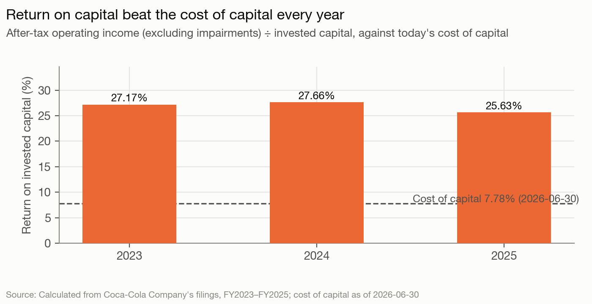
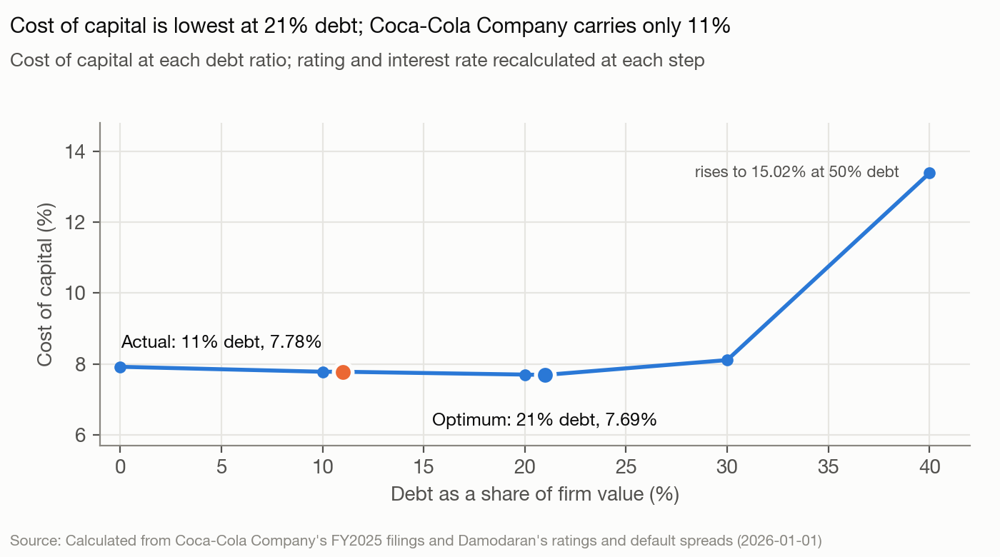

# The Coca-Cola Company — The read, as of 2026-06-30

The Coca-Cola Company (KO) owns the world's largest soft-drink brands and sells concentrate to bottlers it mostly does not own. No one controls it: Berkshire Hathaway holds 9.29% passively, index funds most of the rest, and a new CEO, Henrique Braun, has run it since 2026-03-31 under a board chaired by his predecessor (`governance`). Analysis date 2026-06-30. This is a blind run: nothing published after that date was used (`sources/published.yaml`; `validate-ledger.py` passes with `meta.blind: true`).

## The read

Coca-Cola is a mature, very high-return business: it earns 23.81% after tax on its capital against a 7.78% cost of capital (`model-output.md` sections 1 and 8). Its money choices say the people running it treat the dividend streak and the A1/A+ rating as fixed and everything else as adjustable. It returned 38,954 to shareholders over 2022-2025 against 37,421 of free cash flow to equity, covered 12,173 of one-off payments in 2024-2025 with 7,052 of disposals plus modest borrowing, and carries 11% debt against a 21% optimum, with borrowings lower again in Q1 2026 (section 5; `facts`). Expect the next year's moves to come through the portfolio (closing the African bottler sale, more disposals, an early-2027 dividend raise) rather than the balance sheet. At $81.27 the stock trades at 1.6 times the $50.44 course-method value; the US risk premium alone lifts value to $64.00, and the price is reached only when that is combined with the effective tax rate, growth at the risk-free rate and a 25% stable return ($89.41). The market prices Coca-Cola close to a riskless dollar annuity.

## Signals

| Signal | What it says | What it does | Gap |
|---|---|---|---|
| Control | Split chair and CEO from 2026-03-31; 10 of 12 directors independent; pay tied to EPS (8% CAGR target), revenue and free cash flow (proxy, `sources/statements/stated-by-signal.md`) | Former CEO stays as executive chairman; no holder above 10%; Berkshire passive at 9.29%; the North America head leaves 2026-07-31 and the CFO takes it on an interim basis (`facts: north-america-head-departure`) | Small |
| Life cycle | 4-6% organic revenue, 6-8% EPS algorithm; "asset-light agenda" (FY2025 release) | Revenue +3.69% a year 2022-2025; reinvestment 9-16% of operating income in normal years; 7,052 of disposals in 2024-2025 (`facts`, section 8) | Small |
| Hurdle rate | No hurdle rate disclosed; uses debt "to lower our overall cost of capital" (10-Q) | Cost of capital 7.78%: beta 0.63, weighted ERP 6.50%, A1/A+ debt at 5.14% (section 1) | None |
| Returns | "Disciplined" portfolio building; BodyArmor and fairlife bought as growth brands | ROIC 25.63-27.66% before impairments, 2023-2025; BodyArmor impaired by 1,720 in two years; fairlife earned out at 6,173 (section 8; `facts`) | Small overall, large on acquisitions |
| Leverage | Debt kept at "levels we consider prudent"; A+/A1 rating (10-K) | 11.05% debt ratio against a 21% optimum (24% on APV), peers 21-25%; borrowings 45,492 → 43,890 in Q1 2026 (sections 3, 9; `peers`; `facts`) | Large |
| Debt design | Mix of fixed and floating, short and long, managed with swaps (10-K Item 7A) | About 8.5 years average maturity, 63% dollar, 35% euro, mixed rate (`debt`) | None |
| Payout | Grow the dividend; buy back only to offset dilution in 2026 (10-Q) | Returned 104% of FCFE over 2022-2025 and 161% in 2025; 64 straight dividend raises including February 2026 (section 5; `facts`) | Small (stated and done) |
| Value vs. price | 2026: organic revenue +4-5%, comparable EPS +8-9%, free cash flow about 12,200 (Q1 release) | Value $50.44 against $81.27 (0.62x); peer EV/EBITDA prices it at $45.40, or about $54.82 once the 40,522 of stakes the model's multiple bridge leaves out are added back (sections 6-7; `facts: peer-ev-ebitda-value-with-cross-holdings`) | Large |

**Leverage.** The cost-of-capital approach puts the optimum at 21% (A-), the APV approach at 24%, and the peers sit at 21.34% (PepsiCo) and 24.97% (Keurig Dr Pepper) (sections 3 and 9; `peers`). Coca-Cola is 39,108 of debt short of its optimum (section 3). The prize is small because the curve is flat (7.78% now, 7.69% at the optimum; gain of $0.34 to $2.35 a share, sections 6 and 9), so staying put is a cheap choice, not a mistake. What makes it a signal is direction: in a year when 2026 free cash flow guidance leaves 3,079 after dividends (`facts: fcf-guidance-less-dividends-2026`), the company is paying down debt and says buybacks will only offset dilution.

**Value vs. price.** The DCF on management's growth algorithm gives $50.44, of which $9.42 is the stakes in bottlers and Monster (`company.cross_holdings` 40,522). The three choices that matter most each lift value but none closes the gap alone: the US premium alone gives $64.00, the effective tax rate $54.45, growth at the risk-free rate $55.32. All of them together with a 25% stable return give $89.41 (`alternatives/`). The market is pricing Coca-Cola as a near-riskless dollar annuity; its plan does not need anything more than 4-6% growth to justify a value in the $50s-60s on the course's discount rate.

**Returns.** The core earns far above its hurdle; the acquired brands are mixed. fairlife beat its plan (the 6,173 earn-out, `facts: fairlife-contingent-payment`), while BodyArmor lost 1,720 to impairments in 2024-2025 (`facts: bodyarmor-impairments`), and the 2025 impairment cites "more focused innovation and international rollout plans" (10-K, `sources/statements/stated-by-signal.md`). Pay rewards EPS and revenue growth and cumulative free cash flow, with no return-on-capital measure (`facts: psu-eps-cagr-target`).

## Unstated goals

**Management and the board treat the dividend streak and the A1/A+ rating as fixed, cover cash shocks with whatever mix of disposals and debt keeps both intact, and decline to lever up toward the optimum.** Confidence: medium.
- Evidence: payout: cash returned exceeded FCFE by 3,623 in 2025 and by 1,533 over 2022-2025 (section 5); the shortfall is the 12,173 of one-off payments in working capital, so excluding them payout ran below FCFE (`facts: one-off-cash-payments-2024-2025`). Leverage: 11.05% against a 21% optimum and 21-25% at peers (sections 1, 3; `peers`); net new debt was 2,528 in 2024 and 13 in 2025 (section 5) while 7,052 of disposals came in (`facts: divestiture-proceeds-2024-2025`), and borrowings were 43,890 at Q1 2026 against 45,492 at year end (`facts: q1-2026-total-borrowings`). Stated: 2026 buybacks only offset dilution although guidance leaves 3,079 of free cash flow after dividends (`facts: buyback-2026-intent`, `fcf-guidance-less-dividends-2026`).
- Would be wrong if, between 2026-07-01 and 2027-06-30: the dividend is not raised; or Coca-Cola announces a new buyback authorization of 2% or more of market value (about $7B), or 2026 gross treasury purchases less stock issued exceed $1.5B in the FY2026 cash flow statement; or total borrowings rise more than 10% above 45,492 without an acquisition to explain it (10-K, 10-Qs, 8-Ks).
- Rival reading: indifference, not a goal. The leverage curve is flat (gain $0.34 to $2.35 a share, sections 6 and 9), the 6,000 IRS appeal argues for holding liquidity, and the disposals are a long-stated operating strategy. This rival is strong; the goal stays medium because the predictions it makes (dividend raised, no lever-up, no large buyback) are specific and observable, not because the rival is ruled out.

**The new CEO, with the former CEO as executive chairman, will keep shrinking Coca-Cola toward a pure brand and concentrate company by selling owned operations and non-core businesses.** Confidence: medium.
- Evidence: life cycle: the Africa bottler sale, signed in October 2025, with an option for the buyer on the last 25% (`facts: ccba-sale`); refranchising in India and the Philippines in 2024-2025 and the Global Ventures segment (Costa, innocent) folded into the regions from 2025-01-01 (10-K Note 2 and Item 1, `sources/filings/ko-10-k-2026-02-20.md`). Returns: owned operations earn far less than the concentrate core; Bottling Investments made 426 of operating income on 5,726 of revenue in 2025, against a 28.7% consolidated margin (`facts: bottling-investments-2025`), and BodyArmor was impaired by 1,720 (`facts: bodyarmor-impairments`). Control: Braun, COO since January 2025 and CEO from 2026-03-31, signed the June 2026 separation of the North America head as CEO (`facts: north-america-head-departure`); the January 2026 reshuffle was announced while he was CEO-elect (`facts: ceo-succession`).
- Would be wrong if: between 2026-07-01 and 2027-06-30, apart from the CCBA sale and CCHBC's option on the remaining 25%, Coca-Cola announces no sale of an operating business (a bottler, Costa, or a brand) or of part of a listed bottler or Monster stake worth $500M or more; or it announces an acquisition above $2B of a business with its own manufacturing or retail operations.
- Rival reading: the sales are the tail of a program Quincey started, and a new CEO pauses portfolio moves while he settles. Plausible; the remaining owned bottling after CCBA is small (mostly India), so the next disposal may be a stake sale rather than an operating business. Medium, not high.

**Management manages for EPS growth more than for return on capital.** Confidence: low.
- Evidence: control: pay targets an 8% EPS CAGR and 5% revenue CAGR plus cumulative free cash flow, with no return measure (`facts: psu-eps-cagr-target`). Returns: BodyArmor was impaired by 1,720 while the core's return held at 25-28% (section 8). Against it: fairlife beat its plan and the free-cash-flow measure penalises capital-heavy growth. This rests mostly on one signal (pay design).
- Would be wrong if: the 2027 proxy (filed around March 2027) adds a return-on-capital measure to pay.
- Rival reading: with a 23.81% ROIC the core needs no return target, and growth targets are the right incentive for a business this far above its hurdle. That rival is strong, so this stays low and generates no prediction.

## What to watch

1. **CCBA sale closes by 2026-12-31.** Coca-Cola reports the deconsolidation of its African bottler (8-K, 10-K or the Q4 2026 release). Confidence: medium. Scored as a false alarm if it has not closed by 2026-12-31.
2. **Dividend raise declared by 2027-03-31.** The quarterly dividend rises 3-5%, from $0.53 to $0.55 or $0.56, the 65th straight increase (usually announced with the February results). Confidence: high. Every reading predicts this, so a hit confirms the streak, not the first goal over its rival.
3. **A further disposal of $500M or more announced, 2026-07-01 to 2027-06-30**, not counting the CCBA sale or CCHBC's option on its last 25%: Costa, another company-owned bottler or brand, or part of a listed bottler or Monster stake. Confidence: medium.
4. **No buyback beyond offsetting dilution, through 2027-06-30.** In the FY2026 cash flow statement (10-K, around late February 2027), purchases of stock for treasury less issuances of stock are at or below $1.5B; and no new authorization of 2% or more of market value (about $7B) is announced by 2027-06-30. Confidence: medium. This restates the company's own 2026 intent, so it is weak evidence for the first goal.
5. **New CFO named, or John Murphy made permanent head of North America, 2026-07-01 to 2027-06-30.** Murphy, President and CFO, runs North America on an interim basis from 2026-08-01 (`facts: north-america-head-departure`). Confidence: low.

Also worth tracking, not scored: a ruling on Coca-Cola's appeal of the 2007-2009 transfer-pricing case, which after the Eighth Circuit's October 2025 3M decision the company says it will more likely than not win (10-Q, quoted in `sources/statements/stated-by-signal.md`, hurdle); a win would return part of the 6,000 deposit (`facts: irs-tax-litigation-payment`) and test whether the cash goes to buybacks or debt reduction.

## Discretionary decisions

> ⚠️ **Discretionary Decision: analysis date**
> **Chose:** 2026-06-30, set by the backtest protocol. **Why:** the end of the runner's training data; every rate, price and filing is cut at that date. **Alternative:** none; a later date would break the blind test. **Confidence:** high.

> ⚠️ **Discretionary Decision: beta**
> **Chose:** bottom-up soft-drinks beta 0.5755 unlevered, 0.6291 levered (section 1). **Why:** no regression is allowed in the blind run; the industry average is more precise. **Alternative:** today's relevered 0.68 in the terminal period instead of 0.80 → $54.21 at a 15% stable return (section 6). **Confidence:** medium-high.

> ⚠️ **Discretionary Decision: equity risk premium by region**
> **Chose:** weighted 6.50%, equal-weight country baskets by segment (`country.exposures`). **Why:** filings give segment, not country, revenue. **Alternative:** US premium only, 4.57% → cost of capital 6.70%, $64.00 (`alternatives/erp-us-only-output.md`). **Confidence:** medium.

> ⚠️ **Discretionary Decision: cost of debt**
> **Chose:** A1/A+ rating, 5.14%. **Why:** the 3.3% average coupon reflects old issues. **Alternative:** observed 3.3% → 7.63%, $50.99 (`alternatives/kd-observed-output.md`). **Confidence:** high.

> ⚠️ **Discretionary Decision: weights and debt measure**
> **Chose:** market weights; debt at fair value 40,936 plus leases 1,722 and guarantees 786; the Africa bottler's 1,435 of held-for-sale debt left out (`company.debt_total`). **Why:** rates rose since much of the euro debt was issued; the held-for-sale debt leaves with the sale. **Alternatives:** book weights → 5.63% (section 1); book debt 48,000 → 7.77%, $49.43 (`alternatives/debt-book-output.md`). **Confidence:** high.

> ⚠️ **Discretionary Decision: coverage numerator**
> **Chose:** EBIT (8.32x, AA synthetic). **Alternative:** EBITDA → optimum 22% instead of 21% (section 3). **Confidence:** high.

> ⚠️ **Discretionary Decision: R&D**
> **Chose:** no capitalization. **Why:** Coca-Cola reports no R&D line; product development sits in SG&A and is small. **Alternative:** none computable from the filings. **Confidence:** high.

> ⚠️ **Discretionary Decision: tax rate**
> **Chose:** 25% marginal in the cash flows (model convention). **Alternative:** the 17.88% effective rate → 7.85%, $54.45 (`alternatives/tax-effective-output.md`). **Confidence:** medium; the default understates cash flow.

> ⚠️ **Discretionary Decision: forecast source and stress cases**
> **Chose:** management's 2026 guidance, then 5% growth to 2030 fading to 3% by 2035, margin 31-32% (`forecast.years`). **Alternatives:** 3% growth → $48.39; 28% margin → $45.33 (section 6). **Confidence:** medium.

> ⚠️ **Discretionary Decision: stable period**
> **Chose:** ROIC 15%, beta 0.80, debt 20%, growth 3% → stable cost of capital 8.30% (section 6). **Alternatives:** ROIC 25% → $53.27; growth 4.18% → $55.32 (`alternatives/`). **Confidence:** medium.

> ⚠️ **Discretionary Decision: terminal value method**
> **Chose:** consistent reinvestment, $50.44. **Alternative:** final-year FCFF grown at g → $55.36, implying a 49.37% stable ROIC (section 6). **Confidence:** high.

> ⚠️ **Discretionary Decision: bankruptcy cost**
> **Chose:** 10% of firm value → APV optimum 24% (section 9). **Alternative:** 25% → 21% (`alternatives/bankruptcy-cost-25-output.md`). **Confidence:** medium.

> ⚠️ **Discretionary Decision: peers and the multiple**
> **Chose:** PepsiCo, Keurig Dr Pepper, Monster, Celsius; EV/EBITDA → $45.40 (section 7). **Why:** US filers with XBRL data; CCEP could not be fetched. **Alternative:** without Celsius, EV/EBITDA median 14.55x instead of 15.10x (`alternatives/peers-ex-celsius-output.md`). Coca-Cola's own EV includes 40,522 of stakes not in EBITDA; stripped out it trades at 22.74x (`facts`), and adding the stakes back to the peer-multiple value gives about $54.82 (`facts: peer-ev-ebitda-value-with-cross-holdings`). **Confidence:** medium.

> ⚠️ **Discretionary Decision: cross-holdings**
> **Chose:** listed equity-method stakes at the 10-K's quoted fair value (34,286) plus the rest at carrying value (6,236), added in the bridge and removed from invested capital (`company.cross_holdings`, `company.invested_capital`). **Why:** their income sits below operating income. **Alternative:** keeping them in invested capital, with 2,031 of equity income added to the return, gives about 19.4% ((10,321.5 + 2,031) ÷ 63,577, `facts: invested-capital-incl-equity-investees`, `equity-income-2025`); value per share would drop $9.42 if they were ignored. **Confidence:** high.

## Outside knowledge

- Coca-Cola has pursued refranchising of company-owned bottlers since about 2017 (the "asset-light" model). Public well before 2026-06-30; the filings confirm the recent steps.
- Press reports in 2025 said Coca-Cola was exploring a sale of Costa. Public before 2026-06-30. I am not certain of the details or of any outcome before the cutoff, and the filings name no Costa sale, so watch item 3 rests on the filings' disposal pattern, not on this report.
- BodyArmor was acquired in 2021 and fairlife in 2020 (the latter confirmed in the 10-K). Public before the cutoff.
- Berkshire Hathaway has held 400M shares for decades without trading them. Public before the cutoff; the proxy confirms the holding.
- Nothing in this read comes from knowledge of events after 2026-06-30.

## Sources

- The Coca-Cola Company, Form 10-K for 2025 (filed 2026-02-20) and for 2024 (filed 2025-02-20).
- Form 10-Q for the quarter ended 2026-04-03 (filed 2026-04-30).
- Proxy statement, DEF 14A (filed 2026-03-16).
- Form 8-K earnings releases of 2025-07-22, 2025-10-21, 2026-02-10 and 2026-04-28; officer and director 8-Ks of 2025-10-16, 2025-12-10, 2026-01-14, 2026-02-20 and 2026-06-25.
- Peer 10-K data (PepsiCo, Keurig Dr Pepper, Monster, Celsius) via SEC XBRL company facts, closing prices on 2026-06-30.
- Damodaran: June 2026 implied ERP workbook; January 2026 ratings table, country risk premiums and industry betas. FRED 10-year Treasury close, 2026-06-30.
