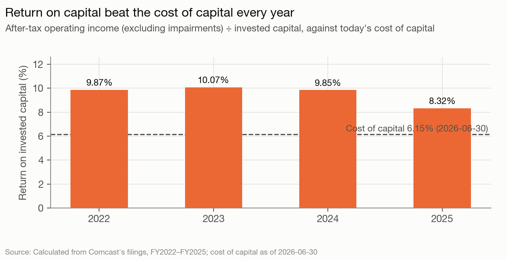
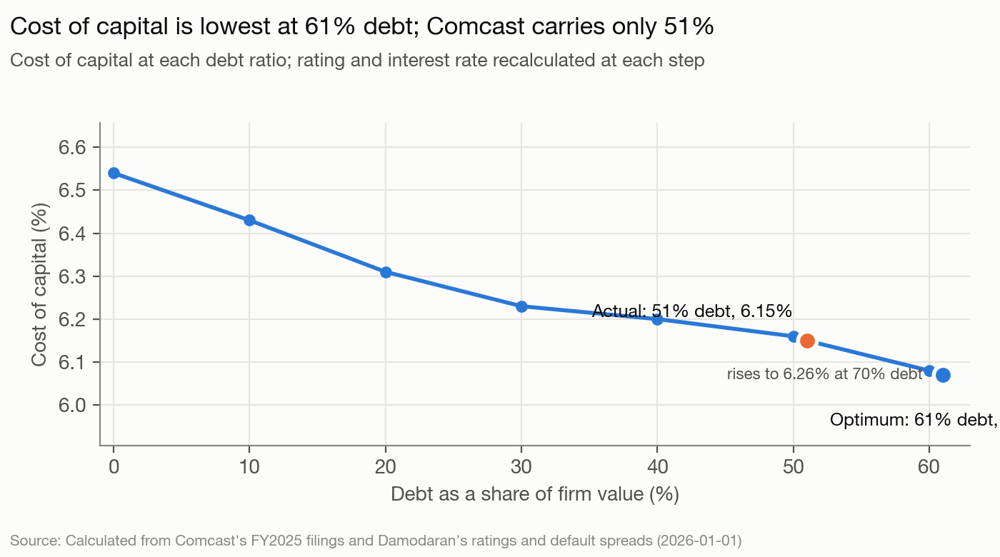

# Comcast Corporation — The read, as of 2026-06-30

Comcast is a US cable, wireless, media and theme-park company controlled by Brian L. Roberts through Class B stock carrying a non-dilutable 33 1/3% of the vote and a veto over any sale (`governance.share_classes`). Analysis date 2026-06-30, quick mode, blind: nothing published after 2026-06-30 was used.

## The read

Comcast's cable franchise still earns more than it costs (return on capital 7.85% against a 6.15% cost of capital), but the margin has narrowed every year since 2023 and broadband customers are leaving. The market prices the stock at $24.55 against $42.64 of value on a plan of 1% revenue growth at today's margin, as if revenue were falling 3% a year at an 11% margin. Management's answer is not more debt or bigger buybacks. It is a second tax-free spin-off (NBCUniversal and Sky, announced 2026-06-29, one day before the analysis date), with debt being paid down, buybacks slowed and the dividend held flat so that both pieces come out investment grade. Roberts keeps dual-class control of both companies. The next twelve months should show the separation financed the way Versant was: new debt at NBCUniversal and a cash payment to Comcast before the spin.

## Signals

| Signal | What it says | What it does | Gap |
|---|---|---|---|
| Control | "Brian L. Roberts will continue to be actively involved in the leadership of Comcast and NBCUniversal"; NBCUniversal "will have the same dual-class share structure" | Class B: 33 1/3% of votes on under 1% of the economics, plus a veto over mergers and asset sales; two spin-offs in 18 months, no sale | Large |
| Life cycle | "position the company for long-term, sustainable growth"; "our pivot is taking hold" | Revenue +0.62% a year 2022–2025, operating income −2.95% a year; Q1 2026 broadband customer net losses 65,000 and Connectivity Adjusted EBITDA −4.3% | Large |
| Hurdle | No hurdle rate disclosed; pay uses three-year ROIC | Cost of capital 6.15% (beta 0.88, cost of equity 8.37%, A- synthetic, pre-tax debt 5.33%) | Small |
| Returns | "Average ROIC" in long-term pay; "invested meaningfully in our six priority areas" | ROIC 10.07% (2023) → 8.32% (2025) → 7.85% pro forma; still above 6.15% | Small |
| Leverage | No numeric target; "strong investment grade balance sheet for each business" | 50.84% debt ratio against a 61% optimum (69% on APV); still retired $4,105M of notes in June 2026 | Large |
| Debt design | "substantially all ... fixed-rate"; foreign notes hedge foreign operations | Fixed, ~13.9 years, ~16% GBP/EUR/RMB, cross-guaranteed by Comcast, NBCUniversal and Comcast Cable | Small (large once the spin starts) |
| Payout | Dividend "consistent with the prior year" ($1.32, after a raise in January 2025); "expect to repurchase additional shares" | Returned $60,092M against $56,466M FCFE over 2022–2025, falling each year; 2025 returned $2,614M less than FCFE; Q1 2026 buybacks $1,260M | Large |
| Value vs. price | No guidance | Value $42.64 against price $24.55 (1.74x); EV/EBITDA 4.92x against a 7.12x peer median | Large |

Stated passages: `sources/statements/cmcsa-stated-positions.md`. Numbers: `inputs.yaml` and `model-output.md`.

**Control.** Roberts' Class B vote and veto (fact `roberts-class-b-vote`) make Comcast unbuyable without him. Over 18 months the board chose two spin-offs (Versant, completed 2026-01-02; NBCUniversal and Sky, announced 2026-06-29) over any sale, and the new company gets "the same dual-class share structure". Roberts stays "actively involved" in both. The independent directors are a majority (9 of 11), but no outcome they chose loosens his control.

**Life cycle.** Operating income before impairments fell from $22,624M (2022) to $20,672M (2025) on flat revenue (model-output.md section 8). Base-year reinvestment is negative (−4.55% of after-tax operating income, excluding acquisition amortization), so fundamental growth is about 0.7% a year at most (fact `fundamental-growth-estimate`). The company's words ("growth", "pivot") describe a turnaround the numbers don't yet show.

**Leverage.** The cost-of-capital curve is flat between 40% and 61% debt (6.20% to 6.07%), so being 10 points under the optimum costs only $1.10 a share (section 3). What stands out is direction: Comcast is under its optimum and is still paying debt down, through the January 2026 redemptions funded by Versant's $2,250M payment (fact `versant-cash-distribution`) and the June 2026 tender. A company managing to its cost of capital would be buying back stock at 0.58x value instead.

**Payout.** Cash returned fell from $18,069M (2022) to $12,049M (2025) while FCFE held at $13.5–16.4 billion (section 5). In January 2026 the dividend was held at $1.32 after a $0.08 raise in January 2025, and Q1 2026 buybacks ($1,260M) ran below the 2025 average of about $1.7B a quarter ($6.8B for the year under the program; the $7,155M in `company.history` also counts shares withheld for employee taxes and excise tax). At $24.55 against $42.64 the course says buy back stock. The company is keeping the cash.

**Value vs. price.** The DCF on 1% growth and a constant 15.57% margin gives $42.64. The broadband-erosion case (revenue −1% a year, 14% margin) still gives $35.11. Only a 3% annual decline at an 11% margin gets to the price ($23.71) (section 6). Peer multiples point the same way ($45.75 at the median EV/EBITDA, section 7). Either the market expects a much steeper decline in connectivity than the history shows, or it applies a discount to a controlled conglomerate. The spin-off answers the second explanation; it does nothing about the first.

## Unstated goals

**1. Management and the board are running the balance sheet for an investment-grade rating through the separation, not for the cost-of-capital optimum, and will finance the NBCUniversal spin the way they financed Versant: new borrowing at NBCUniversal and a cash payment that Comcast uses to retire its own debt.** Confidence: medium.
- Evidence: Leverage: a 50.84% debt ratio against a 61% optimum (69% on APV), yet $4,105M of 2027–2029 notes were retired in June 2026 and the stated aim is "a strong investment grade balance sheet for each business". Payout: the dividend was held at $1.32 in January 2026 and Q1 2026 buybacks ($1,260M) ran below the 2025 pace ($6.8B), while the stock traded at 0.58x the DCF value. Debt design: Comcast, NBCUniversal and Comcast Cable cross-guarantee each other's notes, which has to be unwound before two companies can stand alone. Precedent: before its spin, Versant borrowed $3.0B and paid Comcast $2,250M, which Comcast used to redeem notes (fact `versant-cash-distribution`).
- Would be wrong if: before 2027-06-30, Comcast announces a leverage target above its current level, or uses a cash payment from NBCUniversal for buybacks or special dividends rather than debt reduction, or the Form 10 shows the separation financed with no NBCUniversal-level borrowing.
- Rival reading: the caution is just prudence. Under a 20% fall in operating income the optimum drops to 48% (model-output.md section 4), so with Connectivity Adjusted EBITDA already down 4.3% in Q1 2026, 51% may be close to the right level. The tender may also have been a cheap buyback of notes trading below par. This reading is strong, and it is why confidence is medium rather than high. It is weaker on one point: it doesn't explain why the payout cut and the June tender came in the weeks before a separation that needs two investment-grade balance sheets, exactly as with Versant.

**2. Roberts is breaking the company up in a way that keeps his control of every piece, rather than selling any of it.** Confidence: low.
- Evidence: Control: Class B gives 33 1/3% of the vote and a veto over any merger or sale; the board chose two spin-offs in 18 months; NBCUniversal will copy the dual-class structure, and Roberts stays "actively involved" in both companies. Value vs. price: value is 1.74x price and EV/EBITDA is 4.92x against 7.12x, so a sale of NBCUniversal at a peer multiple was an alternative way to close the gap.
- Would be wrong if: NBCUniversal's Form 10 (or the separation 8-Ks) before 2027-06-30 shows a sunset on its Class B shares, or a Class B without the veto over mergers and asset sales; or Comcast agrees to sell or merge NBCUniversal, Sky or the theme parks.
- Rival reading: dual-class shares and tax-free spins are simply how a Roberts company works, and a taxable sale of NBCUniversal would have cost a large tax bill. In late 2025 Comcast was still trying to buy more media (Outside knowledge), which fits "lost the auction, so split" better than a long-held plan. The value-vs-price evidence is also weak: on connectivity-only peers the discount stays ($41.71 against $24.55), so it is not only a conglomerate discount. This goal mostly rests on the control signal, so it stays low.

*Considered and cut:* that the remaining Comcast is being set up for a cable or wireless deal after the spin (life cycle plus the return of former CFO Michael Angelakis as CEO-designate, `sources/statements/cmcsa-stated-positions.md`). It rests on one signal and couldn't be observed before 2027-06-30.

## What to watch

1. **NBCUniversal registration statement (Form 10), public or announced as confidentially submitted, by 2027-03-31.** Confirms the one-year timetable and shows the debt split and the Class B terms (goal 2's falsifier). Confidence: medium.
2. **New NBCUniversal-level borrowing (notes, term loans, or committed bridge financing) announced by 2027-06-30, sized to fund a cash payment to Comcast before the spin.** Goal 1. Confidence: medium.
3. **Exchange offers or consent solicitations that release the Comcast/NBCUniversal/Comcast Cable cross-guarantees on existing notes, launched by 2027-06-30.** Goal 1. Confidence: low.
4. **Share buybacks under the program total less than $5.1B over the four quarters Q2 2026–Q1 2027 (each 10-Q/10-K Item 5 or Item 2 table, the 2025 pace being $6.8B a year), and no dividend increase is announced in January 2027.** Goal 1. Confidence: medium.
5. **Connectivity & Platforms Adjusted EBITDA declines year on year in at least three of the four quarterly releases from late July 2026 (Q2 2026) to April 2027 (Q1 2027), and domestic broadband customers show net losses in every one.** Tests whether the decline the market prices is under way. Confidence: medium for EBITDA, high for broadband losses.

## Discretionary decisions

> ⚠️ **Discretionary Decision: Analysis date**
> **Chose:** 2026-06-30, set by the backtest protocol. **Why:** the protocol fixes it; the spin announcement came the day before, so the $24.55 close may already reflect it.
> **Alternative:** none run; no other date is allowed in a blind run.
> **Confidence:** high.

> ⚠️ **Discretionary Decision: Base year pro forma without Versant**
> **Chose:** 2025 revenue $116,631M and EBIT $18,155M with Versant removed (estimates from Q1 2025 Versant figures × 4) and $483M of one-time separation costs added back. **Why:** the share price on 2026-06-30 is for a company that no longer owns Versant.
> **Alternative:** as-reported 2025 (revenue $123,707M, EBIT $20,672M) → $52.02 a share, optimum 69% (`alternatives/base-year-as-reported-output.md`).
> **Confidence:** medium; Comcast discloses only one quarter of Versant results.

> ⚠️ **Discretionary Decision: Beta**
> **Chose:** bottom-up, revenue-weighted segments, unlevered 0.4956. **Why:** the regression window is not available in a blind run, and the segments have very different risk.
> **Alternative:** Cable TV only (0.3629) → cost of capital 5.60%, $44.15 (`alternatives/beta-cable-only-output.md`).
> **Confidence:** medium. The stable beta (0.90) is set separately, so this choice changes the discount rate on the explicit years and the rate used to discount the terminal value back, not the terminal capitalization rate.

> ⚠️ **Discretionary Decision: Cost of debt**
> **Chose:** synthetic rating A- from EBIT coverage 4.12x, 5.33%. **Why:** today's borrowing rate, consistent with the remembered agency rating.
> **Alternative:** observed 4.0% effective rate on book debt → cost of capital 5.64%, $44.02 (`alternatives/kd-observed-output.md`). That rate reflects coupons set years ago.
> **Confidence:** high.

> ⚠️ **Discretionary Decision: Weights and debt at market value**
> **Chose:** market weights with debt at disclosed fair value $84,600M plus leases. **Why:** course default; the debt trades 11% below book because rates rose.
> **Alternative:** book weights → 6.04% (model-output.md section 1); debt at book → debt ratio 53.45%, optimum 57%, $39.89 (`alternatives/debt-book-output.md`).
> **Confidence:** high.

> ⚠️ **Discretionary Decision: Coverage numerator**
> **Chose:** EBIT. **Why:** acquisition amortization is non-cash but real lenders look at EBIT-based coverage for an A- issuer; it is the conservative choice.
> **Alternative:** EBIT plus acquisition amortization → optimum 70%; EBITDA → 67% (model-output.md section 3).
> **Confidence:** medium. All three put the optimum above today's ratio.

> ⚠️ **Discretionary Decision: R&D**
> **Chose:** expensed; Comcast reports no R&D line. **Why:** nothing to capitalize. **Alternative:** none computable. **Confidence:** high.

> ⚠️ **Discretionary Decision: Forecast source and stress cases**
> **Chose:** history: 1% revenue growth, 15.57% margin, sales-to-capital 0.67. **Why:** no guidance, no consensus allowed.
> **Alternative:** stress cases → $35.11 (−1%, 14% margin), $41.87 (flat), $43.83 (+2.5%), $23.71 (−3%, 11%) (model-output.md section 6).
> **Confidence:** low-medium; Q1 2026 was worse than the plan.

> ⚠️ **Discretionary Decision: Stable period and terminal value**
> **Chose:** g 2.5%, stable ROIC 7.5%, beta 0.90, debt 40% (stable cost of capital 6.65%); consistent-reinvestment terminal value. **Why:** mature firm; ROIC drifts slightly down; a beta closer to one.
> **Alternative:** ROIC equal to the cost of capital → $39.51; g 1.5% → $40.55 (`alternatives/terminal-growth-1-5-output.md`); final-year FCFF grown at g → $57.83 (section 6).
> **Confidence:** medium. Every choice still leaves value above price.

> ⚠️ **Discretionary Decision: Bankruptcy cost in the APV**
> **Chose:** 15% of firm value. **Why:** subscription customers and advertisers would not flee fast, but programming partners would reprice.
> **Alternative:** 10% or 40% → optimum still 69% (section 9).
> **Confidence:** medium.

> ⚠️ **Discretionary Decision: Peer set and multiple**
> **Chose:** CHTR, T, VZ, TMUS, DIS, FOXA; price on EV/EBITDA. **Why:** connectivity plus media peers match the combined company. Charter's revenue tag was wrong and is left out; Fox lacks EBITDA.
> **Alternative:** connectivity only → median 6.70x, $41.71 (`alternatives/peers-connectivity-only-output.md`).
> **Confidence:** medium. Peer enterprise values use book debt; on book debt Comcast's own EV/EBITDA is 5.21x (`alternatives/debt-book-output.md`). Disney and Fox report on September and June fiscal years.

> ⚠️ **Discretionary Decision: What counts as debt**
> **Chose:** debt at 2026-03-31 plus operating leases; deferred revenue ($4,006M) excluded; June 2026 tender not reflected; programming commitments excluded; the theme-park revenue-interest put (carrying $1.1B, $1.9B at the contract formula, 10-K Note 15) left out as a contingent purchase.
> **Alternative:** reflecting the June tender (debt and cash both lower) → debt ratio 49.67%, $42.61 (`alternatives/post-june-tender-output.md`).
> **Confidence:** high.

> ⚠️ **Discretionary Decision: Valuation-date convention and claims on equity**
> **Chose:** the model's convention, which discounts the forecast from the start of 2026 and bridges with 2026-03-31 debt and cash, compared with the 2026-06-30 price; cross-holdings at book $7,450M; options and RSUs not valued. **Why:** the model has no mid-year option; the investments have no market price in the filings; dilution is small (20M treasury-method shares).
> **Alternative:** rolling value forward half a year at the cost of capital would raise it; valuing cross-holdings at zero would lower it. Neither has a model run (model.py has no valuation-date or haircut field), so no number is given here. Neither changes the sign of the value-to-price gap.
> **Confidence:** medium.

> ⚠️ **Discretionary Decision: Country exposure**
> **Chose:** estimated revenue weights (82% US), weighted ERP 4.77%. **Why:** Comcast doesn't publish revenue by country.
> **Alternative:** US only → cost of capital 6.06%, $44.15 (`alternatives/erp-us-only-output.md`).
> **Confidence:** medium.

## Outside knowledge

- Comcast's agency ratings were A3 (Moody's) and A- (S&P, Fitch) for several years before 2026 (recalled from training; public before 2026-06-30). Not used in the ledger.
- In late 2025 Comcast bid in Warner Bros. Discovery's sale process for its studios and streaming business and did not win (recalled; public before 2026-06-30). Used in goal 2's rival reading: Comcast was still trying to buy media assets in late 2025.
- Charter Communications agreed in May 2025 to combine with Cox Communications (recalled; public before 2026-06-30). Context for the cut goal on cable consolidation.
- Everything else (Versant spin, Hulu sale, Epic Universe opening, NBA rights, the 2026-06-29 announcement) is in the fetched filings.

## Sources

- Comcast 10-K for 2025 (filed 2026-02-03) and 2024 (filed 2025-01-31); 10-Q for Q1 2026 (filed 2026-04-23); proxy statement (filed 2026-04-24).
- Comcast 8-Ks: earnings releases 2025-07-31, 2025-10-30, 2026-01-29, 2026-04-23; Versant separation 2025-12-03, 2026-01-05; co-CEO appointment 2025-09-29 and agreement 2025-12-23; tender offers 2026-05-27, 2026-06-02, 2026-06-03; separation of NBCUniversal and Sky 2026-06-29.
- SEC XBRL company facts for CHTR, T, VZ, TMUS, DIS, FOXA and closing prices on 2026-06-30.
- Damodaran implied ERP (June 2026), ratings table, country risk and industry betas (January 2026); FRED 10-year Treasury, 2026-06-30.
