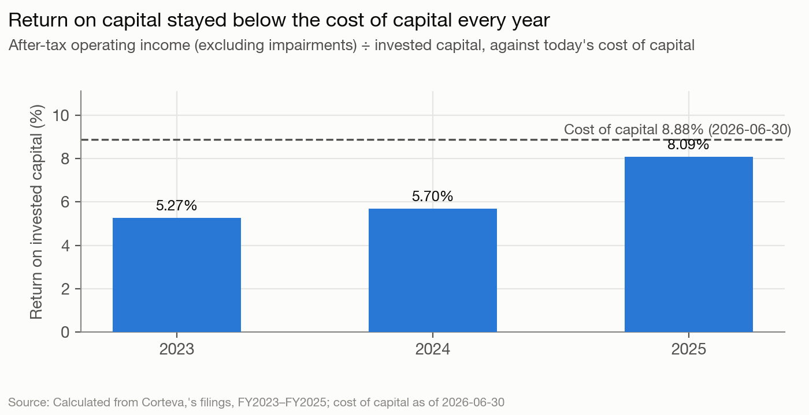
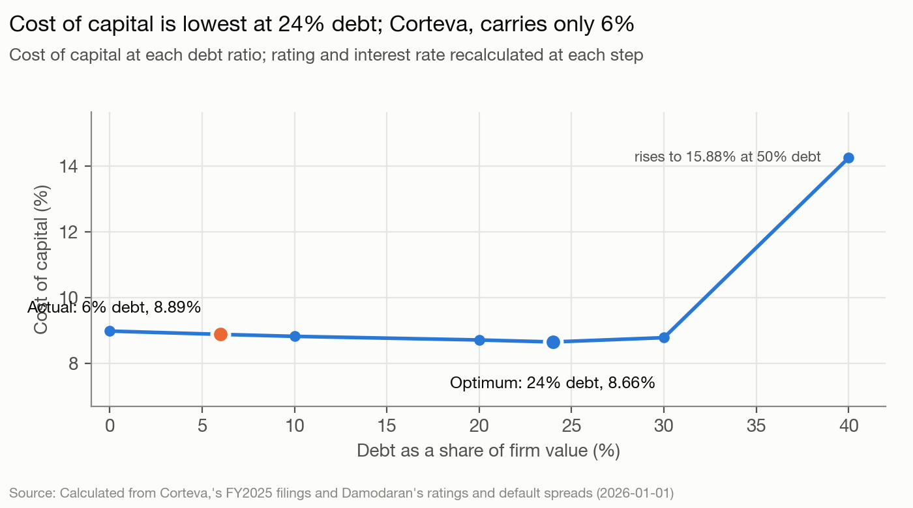

# Corteva — The read, as of 2026-06-30

Corteva, Inc. (CTVA) sells seed and crop protection chemicals worldwide. It is widely held: the three largest holders are index managers with 25.3% between them, insiders hold under 1%, and an independent board chaired by Greg Page runs it. Analysis date 2026-06-30. This is a blind run: nothing published after that date was used. The sources are SEC filings dated on or before 2026-06-29, market data as of 2026-06-30, and peer filings available on that date.

## The read

Corteva is a mature cash generator about to split in two. Revenue was flat from 2022 to 2025 ($17,455M to $17,401M). Profit grew because margins rose. The company returned almost exactly its free cash flow to equity ($5,626M against $5,875M), and it carries only 6.24% debt against a cost-of-capital optimum of 24%. The board is separating a seed business that is gaining pricing power (Vylor, run by the current CEO) from a crop protection business losing price in an oversupplied market (New Corteva, run by an outside chemicals and private-equity operator). The read, at medium confidence, is that the separation is also the moment to use the debt capacity the combined company never used: the $1.5B pension contribution, the halved buyback and the "final capital structures" language all point to new borrowing in the second half of 2026. Crop protection is being set up to cut costs and take part in consolidation rather than grow on its own. The market already prices more than the plan delivers: $84.69 against a status-quo value of $47.10.

## Signals

| Signal | What it says | What it does | Gap |
|---|---|---|---|
| Control | Board "unanimously approved" a tax-free split to "accelerate value" (S1); double-trigger change-in-control only (S5) | Index funds hold 25.3%, insiders under 1%. The incumbent CEO, CFO and CTO go to Seed. Crop protection gets an ex-Albemarle CEO who was a Bernhard Capital partner, and a CFO who ran M&A (S2) | Small |
| Life cycle | Seed a "classic growth compounder"; crop protection in an industry "well supplied ... with market participants" that must "compete differently" (S6, S7) | Revenue flat 2022–2025. Seed EBITDA $2,117M → $2,636M (2023–2025); crop protection $1,374M → $1,350M; Q1 2026 crop protection price −2%, seed price/mix +3% | Small (it says what it does) |
| Hurdle | No hurdle rate disclosed; pay uses RONA (S9) | Cost of capital 8.88%, cost of equity 9.23%, AAA synthetic rating at 13.54x coverage (model-output.md §1–2) | Small |
| Returns | "invested in high-return endeavors" (S10) | ROIC 8.09% against 8.88% on GAAP capital, rising from 5.27% in 2023. 15.06% excluding 2017 merger goodwill (§8; alternatives/roic-ex-goodwill-output.md) | Small |
| Leverage | Investment-grade rating "targeted" for each company; "re-allocation or taking on of new debt" possible (S11, S14) | 6.24% debt against a 24% optimum (A-) and a 27% APV optimum; $10,727.8M below the optimum (§3, §9) | **Large** |
| Debt design | CP and revolvers fund "seasonal working capital"; notes for the long term (S15) | Fixed notes 2026–2033, floating CP at the seasonal peak, small local-currency loans, $6,000M undrawn revolvers | None |
| Payout | "returned more than $1.5 billion" in 2025 (S17); ~$500M buyback "for the first half of 2026" (S16) | 2022–2025 returned 96% of FCFE. 2026 buyback pace halved with $2,180M of authorization unused; dividend payout 43.4%, yield under 1% | Medium |
| Value vs. price | 2026 Operating EBITDA +7% at midpoint (S18) | Status-quo DCF $47.10 against $84.69 (0.56x); peer multiples $29–31; EV/EBITDA 16.05x against a 6.34x peer median (§6–7) | **Large** |

**Leverage.** On every measure the model produces, Corteva borrows far less than it could. The optimum is 24% under EBIT coverage, 35–41% under the other numerators, 19% with operating income down 30%, and 27% under APV (model-output.md §3, §4, §9). Moving to it is worth $2,381.5M (annual savings capitalized) to $2,505.2M (APV). Measured at the year-end trough instead of March, the gap is wider: optimum 28% (alternatives/debt-year-end-output.md). For a widely held company this is not a controller protecting independence. It reflects a board that preferred buybacks paid from operating cash and kept the rating high while the separation was being planned. The 10-Q links the $1.5B pension contribution to "establishing the future capital structures of the two independent companies" (S12). The Q1 release lists debt issuance costs among the separation's expenses (S13). The leverage decision has been postponed to the spin, not abandoned.

**Value vs. price.** No defensible input set reaches the price. A US-only equity premium gives $56.77, a final-year-FCFF terminal value $56.05 (which implies a 23% perpetual return on capital), and GAAP margins $36.63 (§6; alternatives/). The market is paying 16.05x EBITDA, against 6.34x for three fertilizer and ag-input peers that are not seed companies. It is pricing something the status-quo plan does not contain: a premium multiple for the seed franchise after the split (royalty neutrality in 2026, $1B of net royalty income targeted by 2035, S19), or a deal for one of the halves.

## Unstated goals

**The board and management intend to use the separation to add debt the combined company never carried: new borrowing at one or both companies in 2H 2026 to fund the pension contribution and the split, while keeping both investment grade.** Confidence: medium.
- Evidence: (1) Leverage: 6.24% debt against a 24% optimum, $10,727.8M of unused capacity (model-output.md §3). (2) Payout: buybacks planned at ~$500M for the first half of 2026 only, against $1,071M in 2025, with $2,180M of authorization unused (`facts` buyback-h1-2026-plan, buyback-remaining). Cash is being held back while the capital structures are set. (3) Statements and cash position: a $1.5B pension contribution due by 2026-07-31 "in establishing the future capital structures" (S12), against $1,966M of cash and $667M of commercial paper at 2026-03-31. The $600M May 2026 notes also matured (`facts` note-maturity-may-2026), and the Q1 release lists debt issuance costs in the separation (S13).
- Would be wrong if: the combined borrowings, excluding leases, of Corteva and Vylor at 2026-12-31 are below $2,838M. That is 10% above Corteva's $2,580M at 2025-12-31, the same seasonal point; if the spin has not happened, Corteva's borrowings alone are used. The figure shows in the FY2026 10-Ks. Refinancing the matured May 2026 notes alone does not save the goal.
- Rival reading: the board is reshuffling claims, not adding leverage. The unfunded pension ($2,434M) is already debt-like (with it as debt the optimum is 23%, alternatives/pension-as-debt-output.md), the contribution is tax-deductible, and year-end 2025 cash of $4,530M plus 2025 FCFE of $2,106M could pay for it and the $350M of separation costs. "Re-allocation" of existing debt to Vylor (S14) would also fit the language without raising the total. This rival is strong, which is why the goal is medium. Against it: the buyback was halved while cash was available, and the release lists debt issuance costs among separation costs (S13). Both point to new issuance. The size of the gap depends on the model: at the DCF enterprise value of $33,896.7M rather than market value, a 24% ratio would be about $8.1B of debt, still roughly twice today's $3,771M.

**The independent board is setting up post-spin Corteva (crop protection) to cut costs and take part in consolidation of an oversupplied industry, not to grow organically.** Confidence: medium.
- Evidence: (1) Life cycle: crop protection EBITDA flat at $1,374M → $1,350M (2023–2025) and price −2% in Q1 2026, while Seed grew. The company calls the industry "well supplied ... with market participants" and promises "collaboration and partnership across the industry" (S6, S8). (2) Control: the board chose a CEO from outside, a former Albemarle CEO and Bernhard Capital partner, plus a CFO whose last job was leading M&A. The incumbent management moves to Seed (S2), and the new mandate is "asset-light" and "operational efficiency at its core" (S4). (3) Leverage: the crop protection business leaves with unused debt capacity (Corteva as a whole is 18 points below its optimum, §3), while its main US-listed rival FMC was worth $1,438.0M after an operating loss of $1,628M (`facts` fmc-market-cap).
- Would be wrong if: between 2026-10-01 and 2027-06-30, post-spin Corteva announces neither (a) an acquisition, merger, joint venture or divestiture worth at least $375M (5% of 2025 crop protection sales of $7,503M), nor (b) a cost or restructuring programme with a stated dollar target.
- Rival reading: Kissam was hired for his chemicals operating record, and the split is a standard pure-play re-rating with organic plans. The evidence is thin in places. Pricing rests on one quarter. Intent rests on one CEO hire and one CFO profile. The debt capacity is measured for the combined company, not for crop protection alone. FMC's low value shows a target could be cheap, not that Corteva intends to buy. For these reasons the goal stays medium.

## What to watch

1. **Spin distribution by 2026-12-31** (target 2026-10-01): the seed business is distributed to shareholders as Vylor, Inc., a separate listed company. Confidence: high.
2. **CEO and CFO change at Corteva, Inc. at the spin**: Luke Kissam becomes CEO and Jeff Rudolph CFO, replacing Chuck Magro and David Johnson, who move to Vylor (8-K 2026-04-14; `facts` new-corteva-ceo-cfo). Observable in the 8-K on the distribution date, by 2026-12-31. Confidence: high.
3. **Total debt up at least 10%**: Corteva's and Vylor's combined borrowings, excluding leases, at 2026-12-31 are at least $2,838M, against $2,580M at 2025-12-31. Corteva alone if the spin has not happened. Confidence: medium.
4. **Credit rating cut by 2027-03-31**: at least one agency lowers Corteva, Inc.'s long-term rating (the registrant that keeps crop protection) during or after the separation. Confidence: low. The filings disclose no starting rating.

## Discretionary decisions

> ⚠️ **Discretionary Decision: Analysis date 2026-06-30**
> **Chose:** 2026-06-30 close $84.69, FRED rates that day, the June 2026 ERP. **Why:** the backtest protocol fixes it. The last filing in the window is the 2026-06-29 8-K. **Alternative:** none; the date is set. **Confidence:** high.

> ⚠️ **Discretionary Decision: Beta**
> **Chose:** bottom-up 0.8366, Seed at Farming/Agriculture and crop protection at Chemical (Specialty), revenue-weighted. **Alternative:** crop protection at Chemical (Basic) → 0.7557, cost of capital 8.43%, $48.05 (alternatives/beta-basic-chemicals-output.md). **Confidence:** medium.

> ⚠️ **Discretionary Decision: Equity risk premium by revenue**
> **Chose:** 5.75% weighted over six regions, with proxies for EMEA, other Latin America and Asia Pacific. **Alternative:** US premium only, 4.57% → cost of capital 7.91%, $56.77 (alternatives/us-only-erp-output.md). **Confidence:** medium.

> ⚠️ **Discretionary Decision: Cost of debt**
> **Chose:** synthetic AAA, 4.84%. No agency rating is disclosed. The coupon-weighted rate on the notes is about 4.8%. **Alternative:** observed rate gives essentially the same 4.8% (§1). **Confidence:** medium. Real agency ratings are lower than AAA, which would raise the cost of debt slightly and lower the optimum.

> ⚠️ **Discretionary Decision: Market weights, debt at 2026-03-31**
> **Chose:** market equity and March 2026 borrowings plus leases ($3,771M). **Alternative:** book weights → 8.48% (§1). Year-end debt → optimum 28%, $52.05 (alternatives/debt-year-end-output.md). **Confidence:** medium.

> ⚠️ **Discretionary Decision: Coverage numerator**
> **Chose:** EBIT $2,438M before other income and expense. **Alternative:** EBIT + acquisition amortization → optimum 35%, EBITDA → 41% (§3). EBIT after exchange losses and the Bayer charge → 17% (alternatives/ebit-after-other-expense-output.md). **Confidence:** medium. The under-leverage finding holds under all of them.

> ⚠️ **Discretionary Decision: R&D**
> **Chose:** expensed ($1,474M in 2025). **Alternative:** not run. Capitalizing it would raise invested capital and operating income together and leave the leverage and payout findings unchanged. **Confidence:** medium.

> ⚠️ **Discretionary Decision: Forecast source and margin basis**
> **Chose:** 2026 guidance (+7% operating profit), then 3% revenue growth with margin before acquired-intangible amortization rising from 18.4% to 19.9%. **Alternative:** GAAP EBIT margins → $36.63 (alternatives/forecast-gaap-ebit-output.md). Stress cases: flat history → $38.20; crop protection price war → $32.81 (§6). **Confidence:** medium.

> ⚠️ **Discretionary Decision: Stable period and terminal value**
> **Chose:** ROIC 10%, beta 1.0, 20% debt, stable cost of capital 8.75%, growth 3%, consistent reinvestment. **Alternative:** final-year FCFF grown at g → $56.05 (§6). **Confidence:** medium.

> ⚠️ **Discretionary Decision: Bankruptcy cost in APV**
> **Chose:** 15%. **Alternative:** 10% → optimum 31%; 40% → 24% (§9). **Confidence:** medium.

> ⚠️ **Discretionary Decision: Peers**
> **Chose:** FMC, AVD, MOS, CF, SMG (US filers in ag inputs). **Alternative:** none computable. Bayer, Syngenta, BASF and KWS do not file 10-Ks, and the tool failed on Nutrien. **Confidence:** low. Multiples are a floor, not a fair price.

> ⚠️ **Discretionary Decision: Exclusions from debt**
> **Chose:** deferred revenue ($2,773M) and the $2,434M pension/OPEB liability excluded. **Alternative:** pension as debt → optimum 23%, $43.59 (alternatives/pension-as-debt-output.md). **Confidence:** medium.

## Outside knowledge

- Corteva was separated from DowDuPont on 2019-06-01 and carries the 2017 Dow–DuPont merger goodwill and intangibles. This is also in the 10-K. Public before the cutoff.
- The crop protection industry had excess supply and falling generic prices, especially from Chinese producers, through 2023–2025. This is general industry knowledge, consistent with the company's own "well supplied" language (S6). Public before the cutoff.
- Spin-offs commonly put new debt on the spun company and pay cash to the parent before distribution. This is general practice, used only as context for the first goal, whose evidence is in the filings.
- Luke Kissam ran Albemarle until 2020 (also in the 2026-04-14 8-K). Public before the cutoff.
- No agency rating levels, analyst estimates, news, or Vylor Form 10 content were used. The Form 10 (filed under Vylor's own SEC number in late June 2026) would show the planned capital structure. The blind tools fetch only Corteva's filings, so it was not read.

## Sources

- Corteva Form 10-K for FY2025 (filed 2026-02-12) and FY2024 (filed 2025-02-14).
- Corteva Form 10-Q for Q1 2026 (filed 2026-05-06).
- Corteva DEF 14A proxy statement (filed 2026-03-19).
- Corteva Form 8-Ks: 2025-08-26, 2025-10-01 (separation announcement), 2025-11-04, 2026-02-03, 2026-04-14 (leadership, Kissam employment letter), 2026-05-05 (Q1 2026 results), 2026-06-29 (post-separation boards).
- Peer 10-K data via SEC XBRL (FMC, American Vanguard, Mosaic, CF Industries, Scotts Miracle-Gro) and closing prices on 2026-06-30.
- Damodaran: implied ERP (June 2026), ratings and spreads (January 2026), country risk (January 2026), industry betas (January 2026); FRED 10-year Treasury close 2026-06-30.
