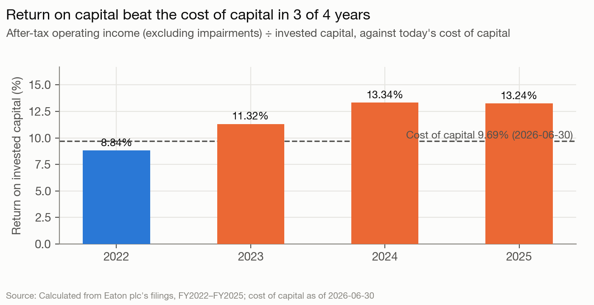
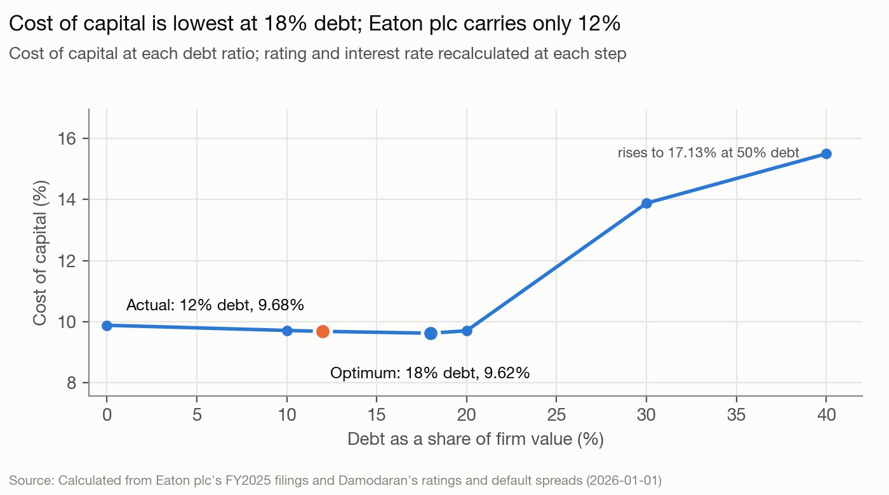

# Eaton Corporation plc — The read, as of 2026-06-30

Eaton is an Irish-domiciled, NYSE-listed maker of electrical power equipment, aerospace components and vehicle drivetrains. It has no controlling holder (Vanguard 9.43%, BlackRock 7.04%, insiders 0.10%), so it is run by management under an independent board with a non-executive chairman: CEO Paulo Ruiz has been in post since 2025-06-01, about a year, and CFO David Foster since 2026-03-02. Analysis date 2026-06-30, quick mode, **blind**: nothing filed or published after 2026-06-30 was used. The filings run up to the 2026-06-11 8-K announcing the Dana transaction.

## The read

Eaton is a fast-growing industrial (EBIT up 19.2% a year 2022-2025) priced as an AI-infrastructure growth stock, and its controllers are spending the balance sheet to keep it priced that way. The shift began under the previous CEO with Fibrebond in April 2025 and accelerated under Ruiz. In twelve months Eaton bought $12.7B of businesses, roughly doubled its debt (debt to EBITDA from 1.73x to 3.55x on 2025 EBITDA), and stopped buybacks for 2026. It also agreed to hand the slow Mobility segment to Dana in a Reverse Morris Trust expected to close in Q1 2027. The core business earns well above its cost of capital (ROIC 13.24% against 9.69%). The deals were bought at about 21 times their first-weeks pre-tax profit, and nothing in the filings yet shows them clearing the hurdle. The price of $426.12 is 2.7 times a DCF anchored on 2026 guidance with an analyst fade after it ($156.54, 0.37x). Expect the next twelve months to bring the Mobility exit, a February 2027 dividend raise, debt paydown and further electrical or aerospace acquisitions. Buybacks should not come back before Mobility is gone.

## Signals

| Signal | What it says | What it does | Gap |
|---|---|---|---|
| Control | Independent board, non-executive chair; pay "correlates with shareholder value creation" (statements S1) | No holder above 10%. Of four pay metrics, two (Adjusted EPS/EBITA) exclude acquired-intangible amortization and deal charges (S1 definition); organic growth, adjusted OCF and relative TSR are the others; none charges for capital (`governance.objectives`) | Small |
| Life cycle | "Positioning Eaton for growth for years to come"; capital to "above-market growth, strong returns" (S2) | Revenue +9.8%/yr, EBIT +19.2%/yr 2022-25; $12,671M of acquisitions in 12 months (data-center electrical, aerospace, a home-electrification stake); buybacks off; low-margin Mobility sold (`facts`) | Small: it says growth and does growth |
| Hurdle | No hurdle disclosed (S3) | Cost of capital 9.69%; levered beta 1.2458; ERP 5.03% (model-output.md §1) | None to compare |
| Returns | "Value-enhancing", "disciplined M&A" (S4) | ROIC 13.24% (2025) vs 9.69%. Pro forma with the deals' annualized stub profits, about 10.6% (`facts.pro-forma-roic-with-stub-profits`). The deals alone start at an estimated 4.8% (Boyd) and 4.6% (Ultra) pre-tax yield on price | Medium; weak evidence |
| Leverage | No target; Mobility cash goes "to repayment of outstanding indebtedness" (S5) | 11.70% debt vs 18% optimum (EBIT; 22% EBITDA; 16% APV); peer median 5.8%; 6.07% before Boyd (`facts.debt-ratio-2025-12-31`) | Small |
| Debt design | Notes for "general corporate purposes, including ... Boyd Thermal" (S6) | Fixed-rate notes maturing 2028-2056 (`facts.notes-2026-maturities`), ~7.5-year average, 22% euro, 12% floating CP; no maintenance covenant (`debt.*`) | None |
| Payout | Dividend raised 6% in February 2026; "does not intend to pursue share repurchases in 2026" (S7) | 2022-25 returned 10,444 of 13,703 FCFE; dividend payout 39.8% vs peer 18.9%; $7,597M authorization unused (§5; `facts`) | Small (stated) |
| Value vs. price | Organic growth guidance raised from 7-9% to 9-11%; adjusted EPS $13.00-$13.50 → $13.05-$13.50 (`facts.guidance-2026-feb`, `facts.guidance-2026-may`) | DCF $156.54 vs $426.12 (0.37x). Multiples are mixed: EV/EBITDA 30.20x vs 24.85x → $339.24; EV/revenue → $432.40 (§6-7) | Large |

**Returns.** Through 2024 Eaton behaved like a mature firm with good projects: returns rose from 11.32% to 13.34%, reinvestment was light, and it bought back $2,492M of stock in 2024. From April 2025 the cash went to deals: Fibrebond (1,430), Resilient (86), Ultra PCS (1,530), Boyd Thermal (9,550). The 2026 buys were funded with $9,890M of notes and $2,497M of commercial paper. Add the deals' first-weeks profit at an annual rate and the enlarged base earns about 10.6%, just above the 9.69% hurdle (`facts.pro-forma-roic-with-stub-profits`). The deals themselves cost about 20.7 times Boyd's annualized pre-tax segment profit (`facts.boyd-price-to-annualized-profit`), before amortization of 5,587 of acquired intangibles. That is roughly a 3.6% after-tax yield on price. Those stubs (19 and 67 days) are weak evidence. Buying back Eaton's own stock at 30x EBITDA would yield even less: after-tax EBIT is 2.1% of enterprise value (`facts.eaton-ev-to-after-tax-ebit-yield`). So the deals are the better of two expensive uses of cash. Whether they create value depends on Boyd's growth.

**Value vs. price.** A DCF anchored on 2026 guidance, faded to 4% growth by 2035, gives $156.54 a share. Faster growth (12% through 2028) gives $187.44; ten years at 11% gives $202.63. With the mature premium alone it is still $175.84. The price needs high growth for well over a decade. Relative pricing is mixed: EBITDA implies $339.24 and revenue implies $432.40. Eaton's EV/EBITDA is overstated because March 2026 debt, which includes the deal funding, is divided by 2025 EBITDA, which excludes the deals. The market is pricing an AI-infrastructure growth story. Management's capital allocation (buying data-center growth, selling vehicle exposure) is aimed at keeping that multiple.

The returns chart shows the pre-deal base and does not yet include the $11,079M spent in Q1 2026.

## Unstated goals

**1. Management and the board want Eaton to keep its growth multiple, and will put the balance sheet into growth acquisitions in electrical and aerospace before returning cash, even at prices that don't yet show a return above the hurdle.** Confidence: medium.
- Evidence: (a) *Life cycle:* $12,671M of acquisitions in twelve months and the exit from Mobility (2025 segment profit 405 on 3,109 of sales), framed as "accretive to ... organic growth rate and operating margins". (b) *Payout:* buybacks stopped (1,862 in 2025, none in Q1 2026) with $7,597M of authority unused while deals were funded with new debt. (c) *Control/pay:* Adjusted EPS and EBITA exclude acquired-intangible amortization and deal charges, and no metric charges for capital, so deals at about 21x profit look accretive in pay terms. (d) *Value vs. price:* the price is 2.7 times DCF value, which holds only while growth stays high. That gives management a reason to keep buying growth. The repositioning itself is stated. The unstated part is the ranking (growth deals before payout) and the tolerance for a thin early return.
- Would be wrong if: before 2027-06-30 Eaton announces restarted buybacks of $1B or more and announces no new acquisition of $500M or more (8-Ks, Q4 2026 release about February 2027, Q1 2027 release about May 2027).
- Rival reading: this is just the previous CEO's electrification strategy carried on, and the deals are fairly priced growth assets bought because buybacks at 30x EBITDA would yield even less (2.1%). That reading fits the numbers. It is why the "below the hurdle" part is left out of this goal's claim (it rests on two stub periods) and why confidence is medium, not high. What it doesn't explain is the pay design, which rewards deal-driven adjusted earnings and organic growth with no return test.

**2. Until Mobility is gone, the board ranks protecting the A-/A3 rating above returning cash: it will repay debt first and keep buybacks off, while the dividend keeps its usual annual raise.** Confidence: low.
- Evidence: (a) *Leverage:* the debt ratio went from 6.07% to 11.70% and debt to EBITDA from 1.73x to 3.55x in one quarter, and the stated use of the $1.1B Mobility cash is debt repayment. The model's optimum (18%, at a BBB rating) says Eaton could carry more, and the gain from moving is small ($1.12-$4.89 a share), so the choice to delever is driven by the rating more than by value. (b) *Payout:* buybacks paused with $7,597M of authority unused. (c) *Debt design:* $2,497M of commercial paper is the obvious first repayment.
- Would be wrong if: Eaton issues new long-term notes to fund a deal above $3B before 2027-03-31, or repurchases shares before Mobility closes.
- Rival reading: there is no hidden goal. Pausing buybacks and repaying debt is the stated plan; it is value-sensible with the stock at 2.7 times DCF value and with a 13% optimum under a 30% profit stress; and the debt capacity may simply be kept for more deals (goal 1). Nothing observable separates this goal from the stated plan, hence low.

## What to watch

1. **The Mobility–Dana RMT closes, completing the separation, between 2027-01-01 and 2027-06-30** (Dana shareholder vote, Form 10/S-4 effectiveness, closing 8-K; company target Q1 2027, `facts.mobility-expected-close`). Confidence: high. The election between split-off (exchange offer, which retires Eaton shares) and pro rata spin-off is announced before close; split-off is slightly favoured. Confidence on the split-off election: low.
2. **The dividend is raised at the late-February 2027 board meeting, by 5-11% from $1.10 a quarter** (the 2026 raise was declared 2026-02-26; per-share raises 2023-2026 were 6.2%, 9.3%, 10.6% and 5.8%, `facts.dividend-per-share-growth-2023-2026`). Confidence: high that it is raised; medium on the range.
3. **At least one acquisition of $500M or more in Electrical or Aerospace announced between 2026-07-01 and 2027-06-30** (8-K or earnings release). Confidence: medium. A deal above $3B funded with new notes before Mobility closes would count against goal 2.
4. **Total debt at least 10% below 21,129 on the first quarterly balance sheet after the Mobility close, at the latest the 2027-06-30 balance sheet** (from about $1.1B of Mobility cash plus commercial-paper paydown out of free cash flow). Confidence: low. Retained cash flow alone gives roughly 5-6% a year; the 10% depends on the close and on the cash going to debt.
5. **No share repurchases in Q3 or Q4 2026** (Q3 10-Q about November 2026; 2026 10-K about February 2027). This is the company's stated plan. Confidence: high. A restart in 2027, after the close, under the existing $9.0B program: low.

## Discretionary decisions

> ⚠️ **Discretionary Decision: analysis date**
> **Chose:** 2026-06-30, set by the backtest protocol; price $426.12, rates of the same date. **Alternative:** none; the date is fixed. Using 2025 year-end balances instead changes value to $184.19 (alternatives/debt-at-2025-year-end-output.md), but that mixes dates. **Confidence:** high.

> ⚠️ **Discretionary Decision: debt date and base-year mismatch**
> **Chose:** debt and cash at 2026-03-31 (after the Boyd financing) with 2025 operating income. **Why:** the debt exists on the analysis date; the acquired businesses' earnings are not yet in any annual report. Coverage and ROIC are therefore conservative, while the forecast includes the acquired revenue from 2026. **Alternative:** 2025 year-end debt → 6.07% debt ratio, optimum 20%, value $184.19 (alternatives/debt-at-2025-year-end-output.md). **Confidence:** medium.

> ⚠️ **Discretionary Decision: beta**
> **Chose:** bottom-up 1.1332, weighted by segment sales with Mobility included. **Alternative:** Electrical Equipment only, 1.1898 → 9.97%, $152.27 (alternatives/beta-electrical-equipment-only-output.md). **Confidence:** medium.

> ⚠️ **Discretionary Decision: cost of debt**
> **Chose:** A- agency rating, 5.33%. **Alternative:** observed 4.13% → 9.59%, $158.19 (alternatives/kd-observed-output.md). **Confidence:** high.

> ⚠️ **Discretionary Decision: interest expense used for coverage**
> **Chose:** run-rate 873 (estimate, range 800-950) built from filed coupons and the commercial paper balance. **Why:** 2025's 351 predates the $11.1B of new debt. **Alternative:** with 351, coverage on the 2025 debt base is in alternatives/debt-at-2025-year-end-output.md (optimum 20%). **Confidence:** medium.

> ⚠️ **Discretionary Decision: weights**
> **Chose:** market. **Alternative:** book → 7.05% (model-output.md §1). **Confidence:** high.

> ⚠️ **Discretionary Decision: coverage numerator**
> **Chose:** EBIT. **Alternative:** EBITDA → optimum 22%; EBIT plus amortization → 18% (model-output.md §3; alternatives/coverage-ebitda-output.md). **Confidence:** medium.

> ⚠️ **Discretionary Decision: R&D**
> **Chose:** expensed (2.9% of revenue). **Alternative:** capitalized over 3 years → ROIC 12.75%, value unchanged at $156.54 (alternatives/rd-capitalized-3yr-output.md). **Confidence:** high.

> ⚠️ **Discretionary Decision: country risk**
> **Chose:** sales-weighted ERP 5.03%, with regional premiums averaged over each region's largest markets. **Alternative:** mature premium only → 9.19%, $175.84 (alternatives/erp-us-only-output.md). **Confidence:** medium.

> ⚠️ **Discretionary Decision: forecast source and stress cases**
> **Chose:** 2026 from guidance (17% revenue growth including deals and FX, 18.7% EBIT margin), then fade to 4% growth by 2035 with margins rising to 20.5%, tax rising from 18% to 25%, and reinvestment at sales-to-capital 2.5 on organic growth. Mobility stays consolidated: the RMT prices it at 8.3x 2026 adjusted EBITDA, about $13.13 a share (`facts.mobility-value-per-eaton-share`), which is close to what a DCF of a low-growth vehicle supplier would give, so leaving it in moves value little. That is a judgment, not a model run. **Alternative:** faster growth → $187.44 (alternatives/forecast-faster-growth-output.md); stress cases $78.34 (capex pause) to $202.63 (AI build-out lasts) (model-output.md §6); tax at 25% throughout → $151.84 (alternatives/forecast-tax-marginal-output.md). **Confidence:** low beyond 2026.

> ⚠️ **Discretionary Decision: stable period**
> **Chose:** ROIC 11%, beta 1.0, debt ratio 11%, growth 3.5% (stable cost of capital 8.63%). **Alternative:** ROIC equal to the cost of capital → $140.82 (alternatives/stable-roic-equals-wacc-output.md); growth 4.18% → $163.31 (alternatives/terminal-growth-at-rf-output.md). **Confidence:** medium.

> ⚠️ **Discretionary Decision: terminal value method**
> **Chose:** consistent reinvestment. **Alternative:** final-year FCFF grown at g → $195.77, which implies a 34.98% stable ROIC (model-output.md §6). **Confidence:** high.

> ⚠️ **Discretionary Decision: bankruptcy cost in APV**
> **Chose:** off in the base, 15% in an alternative run. **Alternative:** 10% → optimum 18%; 40% → 16% (alternatives/apv-bankruptcy-15pct-output.md §9). **Confidence:** medium.

> ⚠️ **Discretionary Decision: peer set and multiple**
> **Chose:** Hubbell, Vertiv, Emerson, Rockwell, Parker-Hannifin, AMETEK, nVent, GE Vernova, priced on EV/EBITDA. Non-US peers (Schneider, ABB, Siemens) file no 10-K. **Alternative:** EV/revenue → $432.40 against $339.24 (model-output.md §7). **Confidence:** medium.

> ⚠️ **Discretionary Decision: what counts as debt**
> **Chose:** borrowings at book (21,129) plus operating leases (789); deferred revenue (1,088) and letters of credit (350) excluded. **Alternative:** debt at fair value (20,575) changes the debt ratio by about 0.3 points; not run because it moves value by less than 1%. **Confidence:** high.

## Outside knowledge

- General context that AI data-center construction drove electrical-equipment demand and valuations through 2025 and the first half of 2026 (public before 2026-06-30). Used only to name the market's story in "Value vs. price"; every number comes from `sources/`.
- Honeywell's planned three-way breakup (announced February 2025), used only to leave it out of the peer set (`sources/README.md`).
- Nothing else from memory. The Dana transaction, the CFO change, the acquisitions and all guidance come from filings dated on or before 2026-06-11. No knowledge of events after 2026-06-30 was used.

## Sources

- Eaton Corporation plc, Form 10-K for 2025 (filed 2026-02-26) and for 2024 (filed 2025-02-27)
- Eaton Corporation plc, Form 10-Q for Q1 2026 (filed 2026-05-05)
- Eaton Corporation plc, DEF 14A proxy statement (filed 2026-03-13)
- Eaton 8-Ks: earnings releases 2025-08-05, 2025-11-04, 2026-02-03, 2026-05-05; credit agreement 2025-09-29; term loan 2026-02-06; notes 2026-03-10; officer and director changes 2025-07-21, 2025-07-23, 2025-11-20, 2026-03-02 (two); Mobility–Dana RMT 2026-06-11
- Damodaran, implied ERP (June 2026), ratings and spreads (January 2026), country risk premiums (January 2026), US industry betas (January 2026); FRED 10-year Treasury and SOFR, 2026-06-30
- SEC XBRL company facts and NYSE closes on 2026-06-30 for Eaton and eight peers
