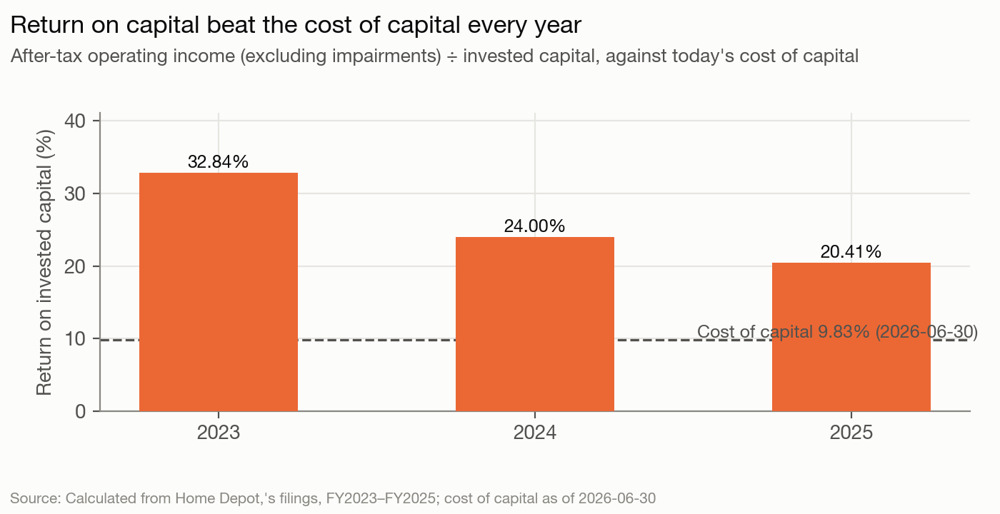
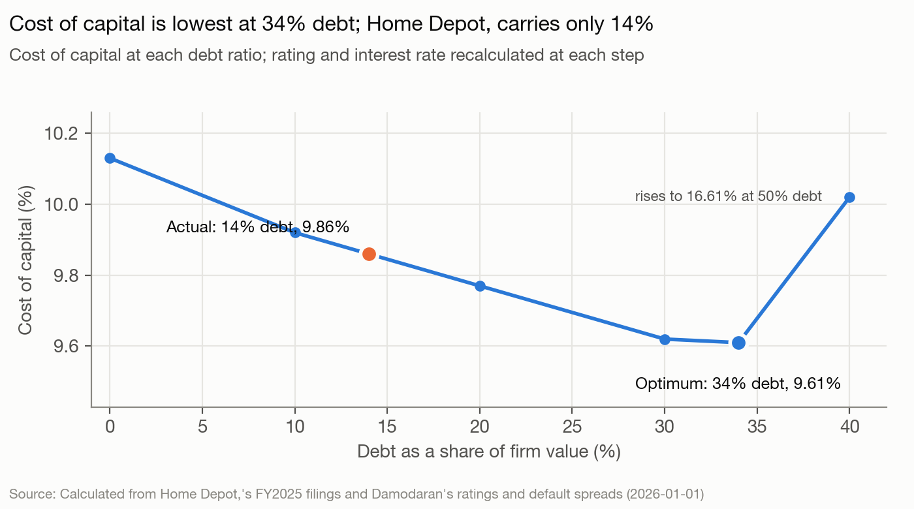

# The Home Depot — The read, as of 2026-06-30

The Home Depot is the largest US home-improvement retailer and, since buying SRS (2024) and GMS (2025), a building-products distributor to trade professionals. Management controls it: Ted Decker is chair and CEO, eleven of twelve directors are independent, and the largest owners are index funds (Vanguard 10.0%, BlackRock 7.1%, insiders 0.08%; `governance.controlling_holders`). Analysis date 2026-06-30. This is a blind run: nothing published after that date was used.

## The read

Home Depot is a mature retailer whose stores have stopped growing. Comparable sales were +0.3% in fiscal 2025 and +0.6% in Q1 fiscal 2026, and operating income fell 4.6% a year from fiscal 2022 to 2025 (`facts`). Management is buying growth instead. It is turning SRS into a distribution business for trade professionals, and it paid for that by halting buybacks and adding debt. Returns are still about double the 9.83% cost of capital, but they fell from 32.84% to 20.41% as invested capital rose $27B: about $23B of acquisitions and about $4B of equity retained during the buyback pause (model-output.md section 8; `facts`). Debt is only 14% of market value against a 34% optimum, yet management is paying it down first. It held the dividend increase to 1.3%, likely so that buybacks, not a bigger dividend, get the cash once debt is down. At $352.68 the price assumes much more than the company's own guidance: the plan is worth $213.96 a share, and peer EBITDA multiples give $280.95 (sections 6–7).

## Signals

| Signal | What it says | What it does | Gap |
|---|---|---|---|
| Control | Independent board, no change-in-control deals, no poison pill (proxy) | CEO is also chair; an independent-chair proposal lost 186.3M to 529.4M votes on 2026-05-21; owners are passive index funds; the bonus weights sales 50% (up from 40%) and half of the performance shares pay on ROIC (`facts`) | small |
| Life cycle | "Reinvest in our business to drive growth faster than the market" (10-K Item 1) | Revenue +1.52% a year fiscal 2022–25, and only through acquisitions; EBIT −4.57% a year; organic reinvestment 16.9% of after-tax operating income (`facts`) | large |
| Hurdle | No hurdle rate disclosed | Cost of capital 9.83%: beta 1.44, cost of equity 10.88%, pre-tax debt 4.84% (section 1) | none |
| Returns | ROIC is the measure that "measures how effectively we deploy our capital base" (10-K) | ROIC 32.84% → 24.00% → 20.41% (section 8). SRS+GMS earned $316M on $12,717M of sales, a 2.5% margin after acquisition amortization (5.6% before it), against 13.5% in the stores (`facts`) | medium |
| Leverage | No numeric target; buybacks paused "as we seek to reduce our outstanding debt" (10-Q) | 14.41% debt at market against a 34% optimum on cost of capital and on APV, below the peer median of 23.7% (sections 1, 3, 9; `facts`). Still reducing debt | large |
| Debt design | Swaps keep about 11% floating; no financial covenants (10-K Note 5) | USD, mostly fixed, 12.5-year average maturity on $46,000M of notes, $3,503M of commercial paper (`debt.*`) | none |
| Payout | Dividend second, buybacks third "after reinvesting" (10-K) | Fiscal 2022–25 returned $49,549M against FCFE of $45,124M. In fiscal 2024–25, cash returned exceeded FCFE by $4,450M, with debt making up the difference. Payout 64.7% against a median of 44.5% for the peers that pay (`facts`). Dividend raised only 1.3% in February 2026 (section 5; `facts`) | large |
| Value vs. price | Fiscal 2026: sales +2.5–4.5%, operating margin 12.4–12.6%, EPS flat to +4% (8-K 2026-05-19) | DCF on that plan $213.96 against a $352.68 price (0.61x). Even a housing-recovery case gives only $234.06. HD trades at 16.36x EV/EBITDA against a 13.51x peer median (sections 6–7) | large |

**Life cycle and returns.** Home Depot calls itself a growth reinvestor. Its organic numbers are those of a mature company. Capex is guided at 2.5% of sales and about 15 new stores in fiscal 2026 (`facts`), and reinvestment excluding acquisitions grows earnings at roughly 3.4% (`facts: fundamental-growth-ex-acquisitions`). The growth it reports comes from buying distributors. Those businesses earned a 2.5% operating margin after acquisition amortization in fiscal 2025 (5.6% before it, with GMS for only five months). Invested capital rose from $49,527M to $76,774M in two years, about $23B of it acquisitions (`facts: acquisitions-cash-fy2024-fy2025`). That is why ROIC fell 12 points while staying above the hurdle. The 10-K blames the ROIC fall on "higher average equity due to our ongoing pause in share repurchases" and higher debt. About $4B of the capital increase is that retained equity, so management's explanation is partly right; the larger part is acquired capital.

**Leverage.** At market values Home Depot is under-levered: 14.41% against an optimum of 34% (35–41% on other coverage measures), and the optimum is still 24% if operating income falls 30% (section 4). At book values, the frame lenders and agencies use, it is not under-levered at all. Book D/V is 82%, and book debt with leases to EBITDA is 2.61x at fiscal 2025 year-end and 2.53x on 2026-05-03 debt (`facts`; 2.37x if the notes are taken at market, not comparable). Management is steering by the second frame. The gain from moving to the optimum is small: $2.49 a share on the DCF and $16.41 on APV (sections 6, 9). So under-leverage costs little, and this is a preference, not a mistake.

**Payout.** Home Depot paid a dividend it could not cover from free cash flow to equity once acquisitions are counted, and it borrowed the difference. It stopped buybacks rather than slow the dividend. It then held the February 2026 increase to 1.3%, after 2.2% in 2025 (`facts: dividend-quarterly-*`). Counted without acquisitions, FCFE was $69,692M and Home Depot returned $20,143M less than that (alternatives/capex-ex-acquisitions-output.md). On that measure the acquisitions consumed what would have been buybacks.

**Value vs. price.** No single input closes the gap. A stable beta of 0.8 with a 15% stable return gives $259.00, a 30% stable return $247.15, the broader retail beta $228.48 (section 6; alternatives/beta-retail-special-lines-output.md). The price needs several of these at once: a housing recovery beyond guidance, a lower discount rate than the bottom-up beta gives, and a stable return near today's 20–26% rather than the 15% assumed. The company's own plan supports none of them.

## Unstated goals

**1. Management (Decker and the board) is turning Home Depot into a trade-professional distribution platform to buy the growth the stores no longer deliver, and will make another sizeable distribution acquisition once debt allows.** Confidence: low.
- Evidence: life cycle: organic growth is near zero. Acquisitions added about $6.3B of fiscal 2025 sales while total sales rose only $5,169M, so sales excluding acquisitions fell (fiscal 2024 had a 53rd week). EBIT fell 4.57% a year (`facts`). Control: the bonus weight on sales rose from 40% to 50% and the fiscal 2026 sales threshold from 90% to 95% of target. The performance-share ROIC and profit targets are adjusted for acquisitions with more than $1B of sales, so a deal does not hurt pay (`facts`). GMS closed on 2025-09-04, 15 months after SRS on 2024-06-18. The 10-K states the aim of "becoming a leading, multi-category building materials distributor".
- Would be wrong if: no acquisition of $1B or more is announced (8-K or press release) between 2026-07-01 and 2027-06-30. A divestiture of an SRS line would also disprove it.
- Rival reading: SRS and GMS were a one-time pivot, and the next years go to integration and debt repayment. The read's own numbers favor this for the window. The acquired businesses earn 2.5–5.6% margins, ROIC is down 12 points, FCFE after acquisitions did not cover the dividend in fiscal 2024–25, and the filings put debt reduction first. That is why this is low. Small tuck-ins by SRS are likely either way and do not discriminate.

**2. Once debt is down, management will send the spare cash to buybacks, not to a bigger dividend.** Confidence: low.
- Evidence: payout: buybacks were stopped rather than the dividend slowed, and the dividend rose only 1.3% in February 2026 after 2.2% in 2025, while $11.7B of buyback authorization (3.3% of market value) stays open (`facts`). Leverage: book debt with leases to EBITDA is falling, from 2.61x to 2.53x. Commercial paper was cut by $961M in Q1 fiscal 2026, and the 10-Q says there will be no buybacks in fiscal 2026 "as we seek to reduce our outstanding debt". The 10-K's capital-allocation order puts buybacks as the outlet for excess cash.
- Would be wrong if: book debt with leases to EBITDA is 2.4x or below at fiscal 2026 year-end (10-K, about March 2027) and no buyback resumption or new authorization is announced by 2027-06-30; or the release of about 2027-02-24 raises the dividend by 5% or more with no buyback plan.
- Rival reading: dividend growth is simply tracking earnings. Net income fell 6.1% a year, fiscal 2026 EPS is guided flat to +4%, and payout is already 64.7%, so a 1.3% raise is what an earnings-linked policy produces anyway. The pay plan does not decide between the readings: its ROIC uses long-term debt plus equity, so repaying debt raises it as much as a buyback does. Two weak signals, so low.

Not inferred: that management keeps debt below the market-value optimum to protect acquisition room. Low market leverage and active debt reduction are the same fact used in goal 2, and the conventional reading (lenders judge Home Depot on book leverage, where it already looks fully levered) predicts the same observables.

## What to watch

1. **Fiscal 2026 results release, about 2027-02-24: the dividend is raised, by less than 3%.** Confidence: high that it is raised (156 consecutive quarterly dividends; raises in February 2025 and February 2026, `facts`); medium that the raise is under 3%. This does not separate goal 2 from its rival; a raise of 5% or more would falsify goal 2.
2. **Total borrowings keep falling through fiscal 2026.** Short-term debt plus long-term debt including current installments, ex operating leases, at fiscal 2026 year-end (10-K, about March 2027) is below $53,509M (2026-05-03, `company.debt_book`): high. At least 10% below the $55,772M of 2026-02-01, that is $50,195M or less: low. Remaining fiscal 2026 maturities are $1,500M (June 2026) and $1,750M (September 2026), plus $3,503M of commercial paper.
3. **An acquisition of $1B or more by Home Depot or SRS announced between 2026-07-01 and 2027-06-30** (8-K or press release). Confidence: low. If one comes and is debt-funded, watch 2's 10% fall fails and goal 2 is pushed out. Any acquisition at all, including SRS tuck-ins disclosed in a 10-Q or 10-K: medium.
4. **A new buyback authorization of at least $7,033M (2% of market value) announced by 2027-06-30.** Confidence: low. $11.7B is still open under the August 2023 authorization, so buybacks can resume without one.
5. **Fiscal 2026 EPS guidance midpoint cut by 5% or more, below about $13.79 from $14.51, at the Q2 (about 2026-08-18) or Q3 (about 2026-11-17) release.** Confidence: low. Q1 comparable transactions fell 1.3% and management cited "housing affordability pressure".

No call is made on CEO or CFO changes, activist stakes or credit-rating changes. The board and owners show no pressure for change (independent-chair proposal 186.3M for, 529.4M against), and the filings disclose no rating to change.

## Discretionary decisions

> ⚠️ **Discretionary Decision: analysis date**
> **Chose:** 2026-06-30. **Why:** set by the backtest protocol; price and rates are from that day, and the balance sheet is from the 10-Q filed 2026-05-27. **Alternative:** none allowed. **Confidence:** high.

> ⚠️ **Discretionary Decision: beta**
> **Chose:** bottom-up, Retail (Building Supply) 1.3177 for the stores and Retail (Distributors) 0.8016 for SRS, giving 1.2778 unlevered. **Why:** course default; HD is the industry's largest member. **Alternative:** Retail (Special Lines) 1.0019 → cost of capital 8.59%, value $228.48 (alternatives/beta-retail-special-lines-output.md). **Confidence:** medium; the Building Supply beta looks high, but the conclusions do not change.

> ⚠️ **Discretionary Decision: cost of debt**
> **Chose:** synthetic AAA from 8.66x EBIT coverage, 4.84%. **Why:** no agency rating in the filings. **Alternative:** the remembered A rating, 5.22% → cost of capital 9.87%, value $213.50 (alternatives/kd-agency-rating-a-output.md). **Confidence:** medium; immaterial.

> ⚠️ **Discretionary Decision: weights**
> **Chose:** market. **Alternative:** book weights → cost of capital 4.94% (section 1), meaningless because $96B of past buybacks shrank book equity. **Confidence:** high.

> ⚠️ **Discretionary Decision: coverage numerator**
> **Chose:** EBIT. **Alternative:** EBITDA → optimum 41% (section 3). **Confidence:** high that HD sits below the optimum on every measure.

> ⚠️ **Discretionary Decision: R&D**
> **Chose:** none capitalized. **Why:** HD discloses no R&D line. **Alternative:** none. **Confidence:** high.

> ⚠️ **Discretionary Decision: what counts as debt**
> **Chose:** notes at market value ($42,510M fair value), commercial paper, finance and operating leases. Deferred revenue ($2,682M) and leases signed but not started (about $675M undiscounted) are excluded. **Alternative:** book debt → value $210.20; leases excluded → D/V 12.36%, value $223.16 (alternatives/debt-at-book-output.md, leases-excluded-output.md). **Confidence:** high.

> ⚠️ **Discretionary Decision: acquisitions as reinvestment**
> **Chose:** counted in capex. **Alternative:** excluded → FCFE $69,692M, so HD returned $20,143M less than FCFE (alternatives/capex-ex-acquisitions-output.md). **Confidence:** high on method. Both measures say acquisitions crowded out buybacks.

> ⚠️ **Discretionary Decision: forecast source and stress cases**
> **Chose:** guidance midpoints for fiscal 2026 (sales +3.5%, margin 12.5%), then 4% growth and a 12.7–12.8% margin to fiscal 2030. **Alternative:** frozen housing $178.97; recovery $234.06; margin squeeze $183.22 (section 6). **Confidence:** medium.

> ⚠️ **Discretionary Decision: stable period**
> **Chose:** beta 1.0, debt 20% (industry), stable ROIC 15%, growth 3.5%; stable cost of capital 7.85%. **Alternative:** ROIC equal to the cost of capital → $153.50; ROIC 30% → $247.15; stable beta 0.8 → $259.00 (section 6). **Confidence:** medium.

> ⚠️ **Discretionary Decision: terminal value method**
> **Chose:** consistent reinvestment. **Alternative:** final-year FCFF grown at g → $230.24 (section 6). **Confidence:** high.

> ⚠️ **Discretionary Decision: bankruptcy cost**
> **Chose:** 15%. **Alternative:** 40% → APV optimum 30%; 10% → 39% (section 9). **Confidence:** medium.

> ⚠️ **Discretionary Decision: peers and multiple**
> **Chose:** LOW, FND, TSCO, BLDR, POOL; EV/EBITDA. **Alternative:** EV/sales → $234.05 (section 7). **Confidence:** medium; peer fiscal years end in December 2025 or January 2026, HD's on 2026-02-01.

## Outside knowledge

- Home Depot's senior debt is rated about A (S&P) and A2 (Moody's). This is remembered and was public before 2026-06-30. It is used only in the cost-of-debt alternative, not in the base case.
- Home Depot management has in the past described a leverage target of roughly 2x adjusted debt to EBITDAR. This is remembered, from investor communications before 2026-06-30, and is not in the fetched filings. It is not used in any goal or threshold.
- US mortgage rates stayed near 6–7% through 2025 and early 2026, keeping home turnover low. This is general knowledge, public before the cutoff, and consistent with the filings' "housing affordability pressure".
- Lowe's bought into Pro distribution in 2025 (Foundation Building Materials; Artisan Design Group). This is remembered, public in 2025, and is context for goal 1's rival reading only.
- Nothing about Home Depot after 2026-06-30 is known to the runner. The watch dates (about mid-August, mid-November and late-February results; 10-Qs about a week later) are inferred from the filing pattern in `sources/filings/index.md`.

## Sources

- Home Depot Form 10-K for fiscal 2025, filed 2026-03-18; Form 10-K for fiscal 2024, filed 2025-03-21
- Home Depot Form 10-Q for the quarter ended 2026-05-03, filed 2026-05-27
- Home Depot 2026 proxy statement (DEF 14A), filed 2026-04-07
- Home Depot 8-K earnings releases of 2025-08-19, 2025-11-18, 2026-02-24 and 2026-05-19; 8-Ks of 2025-09-10 and 2025-09-15 (notes offering) and 2026-05-26 (annual meeting votes)
- SEC XBRL company facts for Lowe's, Floor & Decor, Tractor Supply, Builders FirstSource and Pool, with closing prices on 2026-06-30
- Damodaran, implied equity risk premium (June 2026), ratings and spreads, country risk and industry betas (January 2026); FRED 10-year Treasury and SOFR, 2026-06-30
