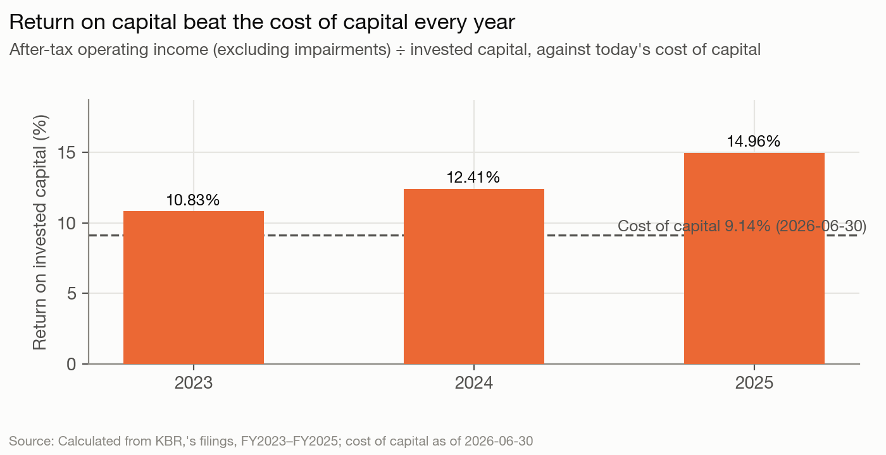
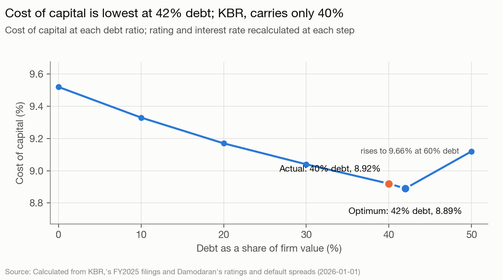

# KBR, Inc. — The read, as of 2026-06-30

KBR is a widely held Houston contractor (government technical services plus energy process technology) run by its CEO-chair, Stuart Bradie; no holder owns more than 15% and insiders own 1.15%. Analysis date 2026-06-30. Blind run: nothing published after that date was used.

## The read

KBR is a mature, acquisition-built company earning 15% on capital (13% without one LNG project's jump in joint-venture earnings) against a 9.1% cost of capital, borrowed near its optimum on the EBIT measure (40% debt vs 42%), and priced at $34.53 against a status-quo value of $51.49. The price is reachable with a flat-revenue, 8.5%-margin case ($34.94) or with a stable beta of 1.27 instead of 1.0 ($41.73), so the gap is less certain than the headline value suggests. Management's agenda is the tax-free spin-off of Mission Technology Solutions, targeted for 2027-01-04: it has paused buybacks ($4M in Q1 FY2026 vs $156M a year earlier), held the dividend at $0.165, and committed the cash SpinCo raises to paying down KBR's debt. One reading, held at low confidence, is that the separation is being set up so the business Bradie keeps (New KBR, the energy-technology side) leaves lighter on debt while SpinCo carries the borrowing. Expect KBR's debt to fall sharply at the January 2027 spin. Organic growth is unlikely to close the price gap before then.

## Signals

| Signal | What it says | What it does | Gap |
|---|---|---|---|
| Control | Spin to "unlock the next phase of value creation"; 2026 KPIs on "delivering a successful transaction" (S1, S5) | CEO-chair; insiders 1.15%; FMR 15.0%, Vanguard 9.85% and BlackRock 9.28% (13G filings from early 2024) (`governance.controlling_holders`); Bradie and CFO Evans (ex-STS CFO) go to New KBR, SpinCo has an interim CEO (S3, S4) | Small |
| Lifecycle | "transformed KBR into a leading provider of ... up-market" solutions (S8); FY2026 revenue +4% (S21) | FY2025 revenue +1%, Q1 FY2026 −5% (`facts.q1-2026-revenue-change`); internal reinvestment rate 5.1% ex-acquisition amortization (MO §8); growth bought (LinQuest $738M) | Medium |
| Hurdle | No hurdle rate disclosed (S11) | Cost of capital 9.14%; levered beta 1.49; weighted ERP 5.38% (MO §1) | n/a |
| Returns | No return target; pay on EPS, cash flow, book-to-bill, TSR (S5) | ROIC 14.96% vs 9.14%, rising from 10.83% in 2023 (MO §8); 12.98% without the LNG equity-earnings jump (alternatives/margin-ex-lng-uplift-output.md); goodwill 68.6% of capital | Small |
| Leverage | Net leverage 2.3x; SpinCo cash "to reduce our level of indebtedness" (S12, S13) | Debt ratio 40% vs optimum 42% (EBIT), 34% if EBIT falls 20% (MO §3–4); peer median 27% (`peers`) | Small today; large after the spin |
| Debt design | Swaps "converting our variable rate debt ... into fixed-rate" (S15) | $2,367M floating bank debt, 3.3-year maturity; $955M of swaps (one at 0.89%) end January 2027 (`debt.rate_type`, `facts.swaps-expiring-jan-2027`) | Medium |
| Payout | Dividend flat "reflecting our focus on consistency and balance‑sheet discipline during the spin" (S16); $427M authorization (S18) | Returned $1,439M 2022–2025 (including $250M of warrant settlements in 2023–2024) vs FCFE after acquisitions $1,501M (MO §5; alternatives/acquisitions-as-capex-output.md); Q1 FY2026 buybacks $4M (`facts.buybacks-q1-2026`) | Large (behaviour changed in 2026) |
| Value vs. price | FY2026 guidance +4% revenue and EBITDA (S21) | Value $51.49 vs $34.53 (1.49x); price equals the flat-revenue, 8.5% margin case ($34.94); EV/EBITDA 7.2x vs peer 10.7x (MO §6–7) | Large |

**Payout.** Through 2025 KBR returned about what it generated once the LinQuest purchase is counted as investment (returned − FCFE = −$62M over four years, alternatives/acquisitions-as-capex-output.md). The model's raw FCFE ($2,326M, MO §5) overstates capacity because it counts the 2024 borrowing that paid for LinQuest but not the purchase. In 2026 the behaviour broke: discretionary buybacks went to zero with the stock at $34.53, below the $49.45 KBR paid in FY2025 (`facts.buyback-average-price-fy2025`) and well below the $51.49 value (MO §6). A firm that bought heavily at $49 and stops at $35 is not acting on value; it is holding capacity for something else.

**Value vs. price.** The DCF on guidance-midpoint revenue and a 10% margin gives $51.49 (MO §6). The market's $34.53 sits on the "flat revenue, margin 8.5%" stress case ($34.94, MO §6). Two specific doubts justify part of that: FY2025 operating income includes $210M of equity earnings, up $103M on one LNG project (`facts.equity-earnings-affiliates`), and Q1 FY2026 revenue fell 5% on the "expected EUCOM contingency runoff" (S22). Removing the LNG uplift gives $41.54 (alternatives/margin-ex-lng-uplift-output.md). A hypothesis, with no number behind it here, is that the rest is a conglomerate discount the spin is meant to remove; the EV/EBITDA gap (7.2x vs 10.7x, MO §7) is consistent with it but uses peers that include engineering firms and does not strip KBR's JV earnings.

The cost-of-capital chart's title says KBR "carries only 40%" against a 42% optimum. The read treats that 2-point gap as at the optimum (value of moving $37.8M, $0.30 a share, MO §3), not as under-leverage.

## Unstated goals

**Bradie and the board are setting up the separation so the business management keeps (New KBR, the STS energy-technology business) leaves with less debt relative to its earnings than SpinCo, and room for acquisitions.** Confidence: low.
- Evidence: (1) Control — Bradie stays as New KBR chair and CEO; the new CFO, Shad Evans, was STS's CFO; SpinCo is run by an interim CEO while a search continues (S3, S4; `governance.board`). (2) Leverage — the 10-Q commits SpinCo's financing proceeds to reducing KBR's debt (S13), and the announcement lists "potential future M&A transactions" as a benefit (S2). The leverage evidence is stated plan, not revealed behaviour, so this rests on one revealed signal.
- Would be wrong if: the Form 10 (expected in the second half of 2026) or the first post-spin filings show New KBR's pro forma net debt / adjusted EBITDA at or above SpinCo's.
- Rival reading: putting debt on the business with steadier US-government cash flows and the larger EBITDA (MTS $579M vs STS $497M, `facts.segment-adj-ebitda-fy2025`) is the textbook design (lesson 23), and a cash distribution to the parent is standard spin mechanics. This rival is at least as strong as the goal.

**The pause in buybacks is elective and New KBR will restart cash return after the separation.** Confidence: low. (That the pause is tied to the spin is stated by the company, S16, S20; only the restart is inferred.)
- Evidence: (1) Payout — buybacks fell from $156M to $4M year on year and the dividend was held after rising every year from $0.48 (2022) to $0.66 (2025) (`facts.dividend-per-share-history`; S16, S19); $427M of authorization remains (S18). (2) Value vs. price — the price is below the $49.45 KBR paid in FY2025 (`facts.buyback-average-price-fy2025`), so a buyer acting on its own earlier judgment of value would be buying; this leans on a DCF the read rates low confidence.
- Would be wrong if: New KBR announces neither a buyback (new authorization or reported repurchases above $50M in a quarter) nor a dividend policy by 2027-06-30.
- Rival readings: (a) the 2026-01-07 Executive Order (10-K Item 1A, S17) lets the Secretary of War limit buybacks and dividends at contractors judged to underperform; (b) the credit agreement limits share repurchases (`debt.covenants`); (c) cash fell $120M in Q1 FY2026 with a $115M JV investment (`facts.bris-investment-q1-2026`), so capacity may simply be tight; (d) ordinary blackout and spin-process caution. None can be ruled out with these filings.

The skeptic pass cut a third goal (joint-venture-led growth): its evidence was management's own "capital-light" language plus one LNG project's earnings, and its falsifier had no date.

## What to watch

Written blind from sources dated on or before 2026-06-30; the run date in the frontmatter is when it was compiled.

| # | Event, window | Expected | Confidence |
|---|---|---|---|
| 1 | SpinCo Form 10 filed publicly with the SEC, by 2026-11-30 | Filed | High |
| 2 | MTS spin-off completed, by 2027-03-31 (target 2027-01-04, S10) | Completed; MTS reported as discontinued or gone in KBR's first post-spin 10-Q | High |
| 3 | KBR total debt (face) in the first 10-Q after the spin (about May 2027) vs $2,617M at FY2025 end | Down at least 10%, repaid from the SpinCo distribution (S13) | Medium |
| 4 | Pro forma net debt / adjusted EBITDA for New KBR vs SpinCo, in the Form 10 or first post-spin filings | New KBR lower than SpinCo (goal 1) | Low |
| 5 | Program repurchases, Q2 and Q3 FY2026 combined (10-Qs, about 2026-08 and 2026-11) | Under $50M; no dividend increase before the spin | Low |
| 6 | New KBR capital return, from the Form 10 to 2027-06-30 | New KBR quarterly dividend per share below $0.165 (it is the smaller company), and a buyback restarted or authorized (goal 2) | Low |
| 7 | FY2026 guidance at the Q2 (about 2026-08) and Q3 (about 2026-11) releases | Consolidated revenue guidance midpoint lowered from $8.13B | Low |
| 8 | Interest cost after $955M of swaps (one at 0.89%) end in January 2027 (`facts.swaps-expiring-jan-2027`) | Higher interest rate on remaining KBR bank debt unless refinanced or repaid | Low |
| 9 | Sale of either company, to 2027-06-30 | None announced (tax-free spin constraint, Outside knowledge) | Medium |

## Discretionary decisions

> ⚠️ **Discretionary Decision: Analysis date 2026-06-30**
> **Chose:** 2026-06-30, set by the backtest protocol; price $34.53 and FRED rates that day; base year FY2025 (the last 10-K filed before the date). **Why:** the backtest fixes the date. **Alternative:** the Q1 FY2026 balance sheet (debt $2,602M, cash $380M) in the bridge → $50.65 (alternatives/q1-2026-balance-sheet-output.md) vs $51.49. **Confidence:** high.

> ⚠️ **Discretionary Decision: Beta**
> **Chose:** bottom-up, 0.9932 unlevered: MTS as Aerospace/Defense (0.869), STS as Engineering/Construction (1.137), weighted by segment adjusted EBITDA. **Why:** no regression series in the blind sources; EBITDA weights proxy value better than revenue for segments with 10% and 22% margins. **Alternative:** revenue weights → value $52.18, WACC 8.91% (alternatives/beta-revenue-weights-output.md); MTS as Computer Services → $50.78, WACC 9.38% (alternatives/beta-mts-computer-services-output.md). **Confidence:** medium; under 2% of value either way.

> ⚠️ **Discretionary Decision: Country risk**
> **Chose:** revenue-weighted ERP 5.38%, regional premiums as simple averages of named countries. **Why:** 45% of revenue is outside the US, over a third of STS revenue in the Middle East and Africa (10-K Note 3). **Alternative:** mature premium only → WACC 8.41%, value $61.39 (alternatives/erp-us-only-output.md). **Confidence:** medium; the largest single judgment on value in this run.

> ⚠️ **Discretionary Decision: Cost of debt**
> **Chose:** observed 6.07% (interest over average face debt). **Why:** the synthetic A- from 4.92x coverage is flattered by JV earnings and a 0.89% swap that ends in January 2027; lenders price KBR as leveraged secured credit. The observed rate itself is net of $21M of swap income, so a gross rate would be higher. **Alternative:** synthetic 5.33% → WACC 8.92%, value $52.15 (alternatives/kd-synthetic-output.md). **Confidence:** medium.

> ⚠️ **Discretionary Decision: Weights**
> **Chose:** market. **Alternative:** book weights → 7.16% (MO §1), because buybacks have shrunk book equity. **Confidence:** high.

> ⚠️ **Discretionary Decision: Coverage numerator and ratings table**
> **Chose:** EBIT, small-firm table (equity $4.4B, below the ~$5B line). **Why:** EBIT already includes the JV earnings that flatter coverage. **Alternative:** EBITDA → optimum 51% (MO §3); large-firm table → optimum 64%, value $51.83 (alternatives/firm-size-large-output.md). **Confidence:** medium; the leverage conclusion ("at the optimum") holds only on EBIT and the small table.

> ⚠️ **Discretionary Decision: R&D**
> **Chose:** expensed; KBR reports no separate R&D line, so nothing is capitalized. **Alternative:** none computable. **Confidence:** high.

> ⚠️ **Discretionary Decision: Forecast source and stress cases**
> **Chose:** management's FY2026 revenue midpoint ($8.13B), 4% growth after, EBIT margin 9.8% then 10%. **Why:** guidance is the only forecast in the sources. **Alternative:** stress cases → $34.94 (flat, 8.5%), $46.86 (4%, 9.4%), $47.73 (2%, plan) (MO §6); margin without the LNG uplift → $41.54 (alternatives/margin-ex-lng-uplift-output.md). **Confidence:** low; Q1 FY2026 already ran below plan.

> ⚠️ **Discretionary Decision: Stable period**
> **Chose:** beta 1.0, debt ratio 27% (peer median), stable ROIC 12%, growth 3%. **Alternative:** today's unlevered beta relevered at 27% (1.27) → $41.73 at a 12% return, $36.78 at a return equal to the cost of capital (MO §6); stable debt at the 42% optimum → $62.02 (alternatives/stable-debt-at-optimum-output.md); growth 2.5% → $48.98 (alternatives/terminal-growth-2-5-output.md); ROIC equal to the cost of capital → $42.24 (MO §6). **Confidence:** medium.

> ⚠️ **Discretionary Decision: Terminal value method**
> **Chose:** consistent reinvestment. **Alternative:** final-year FCFF grown at g → $51.00 (MO §6). **Confidence:** high.

> ⚠️ **Discretionary Decision: Bankruptcy cost in the APV**
> **Chose:** 15% of firm value. **Alternative:** 40% → APV optimum 42%; at 10% or 15% the APV optimum is 69% (MO §9), which the read disregards as an artifact of coarse default steps. **Confidence:** low.

> ⚠️ **Discretionary Decision: Peers and multiple**
> **Chose:** LDOS, SAIC, CACI, BAH, PSN, J, ACM; price on EV/EBITDA. **Alternative:** EV/Revenue → $42.62 vs EV/EBITDA $61.10 (MO §7). **Confidence:** medium; no pure STS-like peer (licensing plus services) is in the set.

> ⚠️ **Discretionary Decision: What is excluded from debt**
> **Chose:** exclude receivables sold to MUFG ($2,094M sold in FY2025, no year-end balance disclosed) and JV performance guarantees (not estimable); include operating and finance leases ($301M). **Alternative:** not computable from the filings; any outstanding sold receivables would raise the debt ratio above 40%. **Confidence:** medium.

## Outside knowledge

- The general US tax rule that a tax-free spin-off is put at risk if either company is acquired as part of a plan around the spin (section 355(e)); this is why the read does not expect a sale of either part before 2027-06-30. General knowledge, public long before 2026-06-30.
- The 2026-01-07 Executive Order is cited only as the 10-K describes it (S17), not from news.
- Nothing about KBR from memory is used beyond what the filings state. The read does not use any credit rating, analyst estimate or news item.

## Sources

KBR, Inc.: Form 10-K for FY2025 (filed 2026-02-26) and FY2024 (filed 2025-02-25); Form 10-Q for Q1 FY2026 (filed 2026-05-05); DEF 14A (filed 2026-03-30); Forms 8-K with exhibits filed 2025-07-09, 2025-07-31, 2025-08-07, 2025-09-24, 2025-10-30, 2026-02-26 and 2026-05-05. Peers' latest 10-K XBRL facts filed on or before 2026-06-30. Damodaran implied ERP (June 2026), ratings spreads, country risk and industry betas (January 2026); FRED 10-year Treasury and SOFR, 2026-06-30. Ledger and model: `inputs.yaml`, `model-output.md` (MO), `alternatives/`, `sources/statements/kbr-stated-positions.md` (S#).
