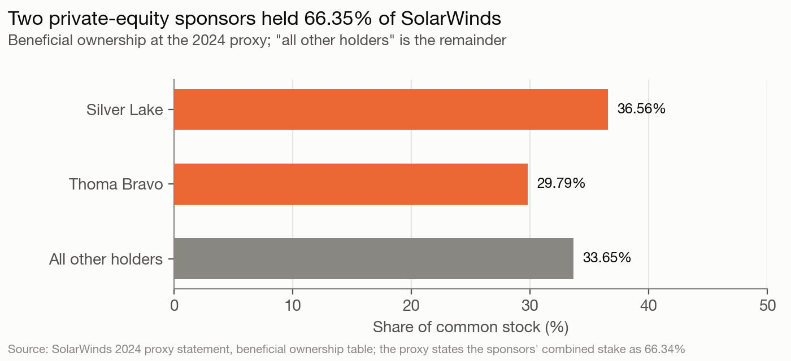
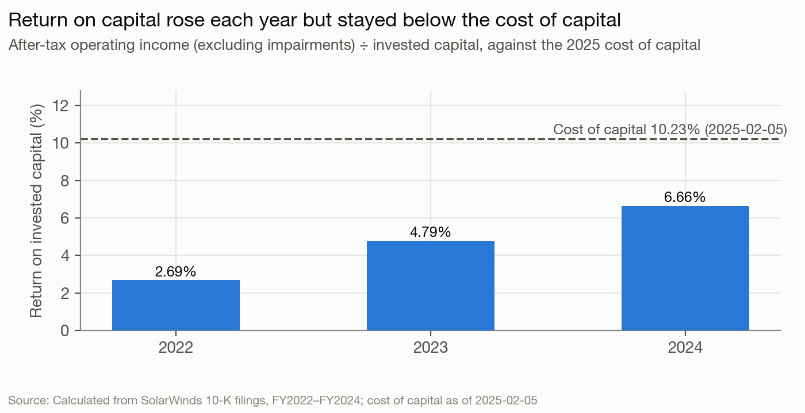
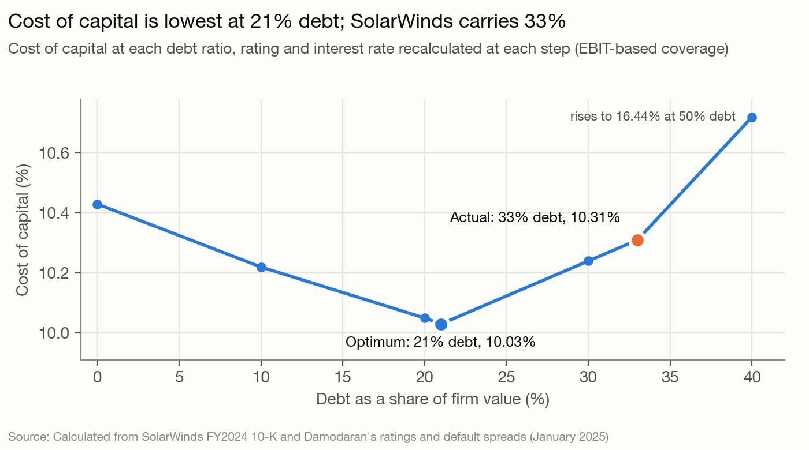
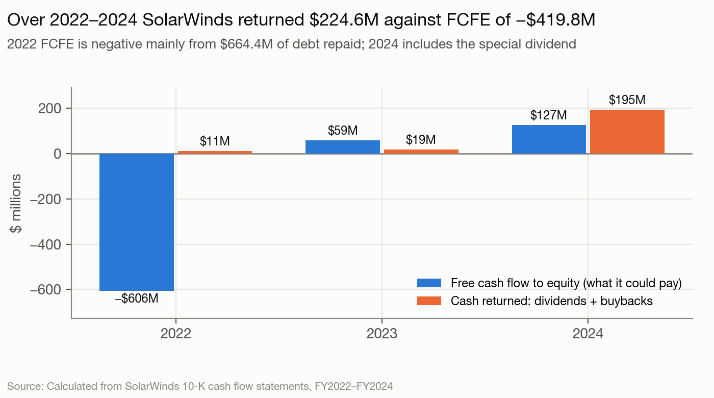
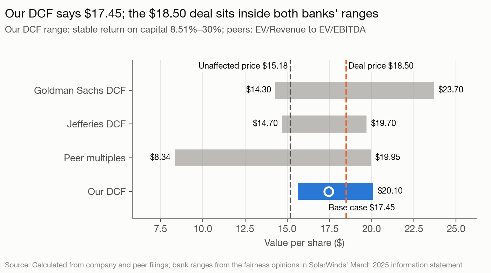

# SolarWinds Corporation — Corporate Finance Assessment and Valuation

Valuation date: 2025-02-05, the last undisturbed trading day before the merger with Turn/River Capital was announced on 2025-02-07, and the date from which both fairness opinions priced. All market inputs are as of that date.

## Executive summary

SolarWinds was a mature, cash-generating software company run for the benefit of two private-equity owners. Silver Lake and Thoma Bravo held two-thirds of the shares, chose the directors that mattered and approved the sale without a public vote.

| | |
|---|---|
| Value per share, status quo (DCF) | **$17.45** |
| Value per share at the optimal debt ratio | $17.68 |
| Market price, 2025-02-05 | $15.18 |
| Deal price | $18.50 |
| Cost of capital: 2025–2030 / after 2030 | 10.23% / 8.51% |
| Return on invested capital, FY2024 | 6.66%; 87% on operating capital excluding goodwill |
| Debt ratio: actual / optimal | 33% / 21% |

- **Does well.** It keeps customers: 93.5% of revenue is recurring, subscription net retention was 99% in 2024, and maintenance contracts renewed at 97%. Its loan has the right rate type and maturity for that business.
- **Does badly.** It earns 6.66% on its capital against a 10.23% cost. It carries more debt than is optimal, 33% against 21%. In 2024 it paid out more cash than it generated, through a $168.2M special dividend, while over-levered.
- **Should do differently.** Repay about $468.1M of debt before returning more cash. Hold new growth spending to a return above the cost of capital.
- **Verdict.** The discounted cash flow valuation is the basis for the conclusion. It puts SolarWinds at $17.45 a share as run, 15% above its market price. The $18.50 deal price was 6% above that. Reaching it would take a return on new capital of about 16% forever, against the 12% assumed here. Management's plan carries the value: at the company's own growth rate the shares are worth $14.17, and the market price sat between the two. For public shareholders, $18.50 was a fair price that paid for the plan.

## 1. Stockholder analysis: who has the power?

Power lies with two inside shareholders, not with managers or the public float. Silver Lake held 36.56% and Thoma Bravo 29.79% at the 2024 proxy. The proxy states their combined stake as 66.34%, a hundredth below the sum of the rounded figures. Officers and directors as a group held 1.95%.

Their control goes beyond ownership:
- **Board seats.** Each sponsor could nominate three directors while it held 20% or more. Of nine directors, three were Silver Lake designees. Eight of the nine counted as independent under exchange rules, including all three of them.
- **Consent rights.** Each sponsor had to consent to any change of control, so a hostile takeover was impossible.
- **The sale.** The sponsors approved the merger by written consent on 2025-02-07, with about 65% of the votes. Public shareholders never voted.

**Conflicts of interest.**
- **Sponsors against public shareholders.** The sponsors had owned the company since 2016 and wanted an exit. The 2024 special dividend paid them about two-thirds of $168.2M.
- **Managers.** The CEO's $22.99M change-of-control package was mostly $19.94M of accelerated equity paid on closing. That tied his reward to completing a deal.

**The marginal investor** was the diversified institution holding the roughly 34% public float. The sponsors did not set the traded price, so market beta is the right measure of risk. Their lack of diversification belongs in a private negotiation, not in the discount rate.

## 2. Risk and return: how risky is SolarWinds, and what is its hurdle rate?

| Input | Value | Basis |
|---|---|---|
| Risk-free rate | 4.43% | 10-year Treasury, 2025-02-05; the US was rated Aaa, so no default spread |
| Equity risk premium | 4.92% | Damodaran's implied US premium of 4.27%, plus a country premium on the 35.18% of revenue earned outside the US |
| Unlevered beta | 1.22 | Software industry, cash-corrected (Damodaran, January 2025) |
| Levered beta | 1.6714 | Relevered at a debt-to-equity ratio of 0.4933 and a 25% marginal tax rate |
| Cost of equity | 12.65% | 4.43% + 1.6714 × 4.92% |
| Pre-tax cost of debt | 7.11% | The term loan's effective rate, SOFR + 2.75% (FY2024 10-K) |
| After-tax cost of debt | 5.33% | 7.11% × (1 − 25%) |
| Debt ratio, market values | 33.03% | Debt $1,285.0M; equity 171.6M shares × $15.18 = $2,604.9M |
| **Cost of capital** | **10.23%** | 66.97% × 12.65% + 33.03% × 5.33% |

**Beta.** A regression beta was not possible: free price sources no longer serve the delisted ticker, and Capital IQ's price history would not load. The bottom-up beta is the better measure in any case. SolarWinds reports one segment, so the software industry beta applies to the whole firm.

**Debt** is the loan at face value, $1,235.7M, plus $49.4M of lease liabilities. Deferred revenue of $389.3M is owed in service, not cash. Cloud purchase commitments of $68.4M are payments for a service the company uses. Both are excluded.

**Cost of debt.** No agency rating is disclosed. Interest coverage of 1.85 times (operating income of $208.4M against interest expense of $112.4M) implies a synthetic B- rating and an 8.85% cost of debt. Interest expense ran above today's rate because the loan's effective rate fell during 2024, from 9.11% to 7.11%, as rates and the loan's margin came down. The 7.11% the loan pays at the valuation date is a market price set by its lenders, so it is the cost of debt used.

**Market or book weights.** At book values, debt would be 47.28% of capital and the cost of capital 9.19%. The book version leans on cheap debt because the market values equity at 1.86 times book. Market weights are the right ones.

## 3. Investments: how good are SolarWinds' existing investments?

Return on invested capital rose from 2.69% in 2022 to 6.66% in 2024, but stayed below the 10.23% cost of capital every year. In 2024 the shortfall cost $84.0M of economic value added. Return on equity was 7.99% against a 12.65% cost of equity.

The capital base explains much of the gap. Goodwill from the 2016 buyout and later acquisitions is 100.65% of invested capital, so the return is measured against the price the sponsors paid, not against the operating assets. A typical SolarWinds project is a small, repeated spend on product development, paid back over years of subscription renewals. The large, lumpy investments were acquisitions funded with debt, and those are what the low return reflects. Future projects are uncertain: bidders in a 2023 sale process doubted the move to subscriptions, citing its "early stage".

**Capitalizing research and development** does not change the headline. SolarWinds spent $108.6M on R&D in 2024, 13.6% of revenue, and expenses it. Treating the last three years' R&D as an asset with a three-year life, the life Damodaran uses for software, adds a $206.2M research asset to capital and $10.5M to operating income (R&D less $98.1M of amortization). The adjusted return on capital is 6.53%, because the capital base is still the goodwill. Strip the $2,363.2M of goodwill out and the business runs on $191.0M of capital, on which it earns 87% (61% on a five-year life). The 6.66% measures the price the sponsors paid in 2016. The operating business is capital-light, and that matters for the terminal value in section 9.

## 4. Capital structure choices: how is SolarWinds financed?

SolarWinds uses both ends of the debt-equity continuum and nothing in between. From most debt-like to most equity-like:

1. Operating leases, $49.4M.
2. A first-lien term loan, $1,235.7M at face, senior, secured and floating-rate.
3. A $130.0M revolving credit facility, undrawn at year-end.
4. Restricted stock units and options, worth $187.0M at the unaffected price.
5. Common stock: one class, one vote a share, listed in the 2018 IPO.

There is no convertible debt and no preferred stock.

**The trade-off.** Debt saves about $28.1M a year in taxes. Its discipline benefit is small, because managers already answer to two controlling owners. Against that:
- **Interest is heavy.** It takes 55.5% of operating cash flow.
- **Rates.** Each percentage point on interest rates costs about $12.4M a year on the floating-rate loan.
- **Flexibility.** The loan had to be refinanced on a sale.

On the qualitative weighing, SolarWinds has too much debt.

## 5. Optimal financing: what is the right mix of debt and equity?

The cost of capital is lowest, at 10.03%, with 21% debt and an A- rating. This schedule re-estimates the rating and interest rate at each debt ratio. At the actual 33% that method gives a B rating and 10.31%, slightly above the 10.23% in section 2, which uses the loan's actual 7.11% rate. Moving to the optimum saves $10.9M a year, worth $144.4M in perpetuity. SolarWinds carried $468.1M more debt than the optimum.

| Debt ratio | Levered beta | Cost of equity | Rating | Pre-tax cost of debt | Cost of capital |
|---|---|---|---|---|---|
| 0% | 1.220 | 10.43% | AAA | 4.88% | 10.43% |
| 10% | 1.322 | 10.93% | AA | 5.03% | 10.22% |
| **21% (optimum)** | 1.463 | 11.63% | A- | 5.38% | **10.03%** |
| 30% | 1.612 | 12.36% | B+ | 7.04% | 10.24% |
| **33% (actual)** | 1.671 | 12.65% | B | 7.43% | **10.31%** |
| 40% | 1.830 | 13.43% | B- | 8.85% | 10.72% |
| 50% | 2.135 | 14.93% | C | 19.93% | 16.44% |

The result holds under other assumptions. Measuring coverage on EBITDA gives an optimum of 28%, still below 33%. A 30% fall in operating income lowers the optimum to 14%. The adjusted present value approach reaches the same 21% and values the move at $220.3M.

## 6. Financing changes: should SolarWinds move to the optimum, and with what debt?

**Whether and how fast.** SolarWinds should move, but gradually:
- **No takeover pressure.** It cannot be taken over against the sponsors' will.
- **No near-term bankruptcy threat.** It has $259.3M of cash and an undrawn revolver, its covenant applies only when the revolver is more than 35% drawn, and the loan does not mature until 2030.
- **Repay from cash flow.** The best path is to repay debt out of free cash flow to equity, with no special dividends until the ratio nears 21%. At 2024's $127.0M, repaying $468.1M takes about 3.7 years (468.1 ÷ 127.0); using part of the cash balance shortens that.
- **No equity issue or recapitalization.**

**The right type of debt.** Debt should match the assets it funds:

| Characteristic | Right for SolarWinds | Actual |
|---|---|---|
| Rate | Floating: annual price increases give it pricing power | Floating, SOFR + 2.75% |
| Maturity | Medium term, four to six years | 5.0 years, one maturity in 2030 |
| Currency | Dollars and euros in proportion to cash flow; at most 35.18% foreign | All US dollars |
| Form | Straight debt | Straight debt, no swaps |

Rate type, maturity and form fit; the problem is size. Two mismatches remain:
- **Currency.** No debt is in euros, the currency of most of the foreign revenue. A euro tranche could be added at refinancing, once net foreign cash flow is measured; the filings do not size it.
- **Maturity.** The single 2030 maturity could be staggered.

## 7. Dividend policy: how does SolarWinds return cash?

SolarWinds has no regular dividend. In five years it paid two special dividends:
- **2021:** $237.2M, $1.50 a share, funded by $238.2M of cash N-able paid SolarWinds at its spin-off.
- **2024:** $168.2M, $1.00 a share.

Its only other cash return is shares withheld for employees' taxes on vesting stock. In 2024 the dividend was 150.3% of net income. Counting withheld shares, cash returned was 174.0%. The dividend yield was 6.59% at the $15.18 unaffected price. No price on the record date is available.

Against the sector, this is an outlier. Most of the eight peers paid no dividend, and the wider software group paid out 27.22% of earnings. On the course's three views of dividends, SolarWinds fits none: its payments followed no earnings trend and were not sticky. The likeliest driver of the 2024 dividend is the sponsors' preference; with their stakes unchanged from the proxy, about two-thirds of it went to them. That is an inference, not a stated reason.

## 8. Dividend assessment: should SolarWinds return more or less cash?

Over 2022–2024, free cash flow to equity totaled −$419.8M against $224.6M returned. The negative total comes from 2022, when the company repaid $664.4M of debt. Years before 2022 include N-able and are not comparable. The years that describe the business today:
- **2023:** free cash flow to equity of $59.4M; $18.8M returned.
- **2024:** $194.7M returned against $127.0M of free cash flow to equity, $67.7M more than it generated. Cash fell from $289.2M to $259.3M.

**Should investors trust SolarWinds with cash?** No. On all the capital invested in it, SolarWinds earns 6.66% against a 10.23% cost. Its operating business earns far more on very little capital, which is the point: it has few places to put new cash, so cash kept in the business idles or goes to acquisitions, and acquisitions are what the 6.66% reflects. Returning cash was right. Paying it out as a dividend while debt sat $468.1M above the optimum was not. SolarWinds should have returned less to stockholders and used the cash to repay debt.

## 9. Valuation: what is SolarWinds worth?

### Discounted cash flow

**Cash flows** are management's 2025–2030 forecast from the merger information statement, with stock-based compensation charged as an expense:
- Free cash flow to the firm rises from $212.0M in 2025 to $419.0M in 2030.
- Revenue grows 8.12% a year, against 5.0% in 2024, and the operating margin rises from 32.69% to 40.14%.
- On SolarWinds' own fundamentals (return on capital times reinvestment), growth would be about zero. The forecast assumes the margin plan delivers.

**Two discount rates.** The forecast years are discounted at 10.23%. After 2030, growth is 2.5% a year and the terminal value uses a stable-period cost of capital. A mature firm's beta moves toward one and its debt toward its optimum, as in the course's own Disney valuation:

| Stable-period input | Value |
|---|---|
| Beta | 1.00 |
| Cost of equity | 9.35% (4.43% + 1.00 × 4.92%) |
| Debt ratio | 21%, the optimum |
| After-tax cost of debt | 5.33%, held at today's rate |
| **Stable cost of capital** | **8.51%** |
| Return on new capital | 12%, 3.5 points above the stable cost of capital |
| Reinvestment rate | 20.83% (2.5% ÷ 12%) |

The return on new capital is a judgment. Section 3 showed that the business earns 87% on its operating capital, keeps 99% of its subscription revenue and raises prices every year, so new capital should earn more than it costs. It also showed a shrinking license business and faster-growing rivals, so the excess fades. A 12% return, 3.5 points over the stable cost of capital, sits between those two facts. The course's Disney valuation used a 2.7-point spread. Setting the return equal to the cost of capital, so that growth adds nothing, gives $15.63; the sensitivity table below shows the rest of the range.

| Bridge | Status quo | At the optimal debt ratio |
|---|---|---|
| Present value of 2025–2030 cash flows | $1,321.6M | |
| Present value of terminal value | $2,885.4M | |
| Enterprise value | $4,207.0M | $4,247.4M |
| − Debt | $1,285.0M | |
| + Cash (at face value; no cross holdings or minority interests) | $259.3M | |
| − Options and restricted stock units | $187.0M | |
| **Value per share** (171.6M shares) | **$17.45** | **$17.68** |

**The terminal-value method matters.** Growing the 2030 cash flow at 2.5% forever gives $23.86 a share. That method assumes SolarWinds grows without reinvesting: in 2030 capital spending barely exceeds depreciation, and customers prepay $46M more than the year before. Matching that cash flow would need reinvestment of −9.33% of operating income forever, so the reinvestment-consistent value is the right one.

**What it takes to reach $18.50.** The deal price requires SolarWinds to earn excess returns forever:

| Return on new capital after 2030 | 8.51% | 10% | **12% (used)** | 15% | 20% | 30% |
|---|---|---|---|---|---|---|
| Value per share | $15.63 | $16.56 | **$17.45** | $18.33 | $19.22 | $20.10 |

The deal price needs a return a little above 15% in perpetuity. The 10% column is the assumption the course used for Disney, whose competitive advantages it expected to persist; it gives $16.56. The defensible range runs from $15.63, no excess returns, to $18.33.

**What if the plan is wrong.** The forecast carries more of the value than the terminal return does. Rerunning the valuation with revenue growing at the 2022–2024 rate of 5.25% instead of 8.12%, with the same terminal assumptions:

| Case | 2030 revenue | 2030 free cash flow | Value per share |
|---|---|---|---|
| Management's plan: 8.12% growth, margin 32.7% to 40.1% | $1,273.0M | $419.0M | $17.45 |
| Historical growth, plan margins | $1,083.3M | $345.3M | $14.17 |
| Historical growth, margin held at 32.7% | $1,083.3M | $284.7M | $10.81 |
| Historical growth, margin held at 2024's 26.2% | $1,083.3M | $231.6M | $7.32 |

The margin expansion matters more than the growth. The market price of $15.18 sat between the history-based $14.17 and the plan-based $17.45, which is where a price lands when investors half-believe the plan.

**Against the banks.** The fairness opinions valued SolarWinds at $14.30–$23.70 (Goldman Sachs) and $14.70–$19.70 (Jefferies). $17.45 sits inside both, in the lower half of Goldman's range and near the middle of Jefferies'. Their higher midpoints come mainly from growing the final-year cash flow, the method that gives $23.86 here.

### Relative valuation

| Multiple | SolarWinds | Median of eight peers | Implied value per share |
|---|---|---|---|
| Enterprise value / EBITDA | 12.84x | 16.39x | $19.95 |
| Price / earnings | 23.28x | 26.57x | about $16.24 |
| Enterprise value / revenue | 4.56x | 3.32x | $8.34 |
| Price / book | 1.86x | 4.58x | not used |

The peers are the eight US-listed companies in Jefferies' fairness-opinion set. **EV/EBITDA is the best multiple here.** It is not distorted by SolarWinds' debt or one-time items. Revenue multiples ignore that peer margins range from −18% to 31%. Price to book is set aside because SolarWinds' book equity rests on buyout goodwill and buybacks have shrunk some peers' equity. The peers grew from −9.3% to 9.6%, so the median is not adjusted for growth. EV/EBITDA gives $19.95 and price to earnings about $16.24, so the market's own pricing puts SolarWinds at $16 to $20. That brackets both the market price and the deal.

### Value with changes, and the deal

**Value with changes.** The financing change in section 6 raises value to $17.68 a share, a gain of $0.24. The gain is small because the stable period already assumes the 21% optimum, so only 2025–2030 benefits. The gain is larger on other bases: $144.4M ($0.84 a share) from capitalized annual savings and $220.3M ($1.28) from adjusted present value. Those measure the change at a constant firm value, before any forecast. The operating changes are not priced separately: the margin expansion is already in management's forecast.

**Likelihood of change.** Under the existing owners it was low. In 2024 they chose a special dividend over repaying debt. What happened instead was a sale. The buyer's financing runs the other way: $2,750M of new term loans, more than double the $1,285.0M SolarWinds carried. A private-equity buyer borrows to raise the return on its own equity, not to lower the company's cost of capital.

**The deal.** $18.50 was 6% above intrinsic value as run and 22% above the market price. It is consistent with a buyer that believes the margin plan in full, expects a return on new capital somewhat above the 12% assumed here, and uses far more debt to raise the return on its own equity. The market price of $15.18 was 13% below intrinsic value on the plan, between the history-based and plan-based values. That is what a price looks like when investors discount management's forecast, and the sponsors, who knew the plan best, took the other side.

## Conclusion

| Principle | What SolarWinds does | What it should do |
|---|---|---|
| Objective and governance | Runs for two controlling owners; the public float had no vote on the sale | Give the minority a real voice on a change of control |
| Investment | Earns 6.66% against a 10.23% cost of capital on a capital base of buyout goodwill | Hold new spending to a return above the cost of capital |
| Financing | 33% debt against a 21% optimum; the right type of debt, too much of it | Repay about $468.1M from free cash flow before any special dividend |
| Dividends | Pays out more than it generates, in special dividends, while over-levered | Repay debt before returning more cash |
| Valuation | Worth $17.45 a share as run, 15% above the market price | $18.50 was a fair price for the public shareholders: 6% above intrinsic value, with the plan priced in |

## Sources

SolarWinds Forms 10-K (FY2018, FY2020, FY2023, FY2024), 2024 proxy statement, 2018 IPO prospectus, Forms 8-K (February and April 2025) and merger information statement (March 2025, including the Goldman Sachs and Jefferies fairness opinions and management's forecast); Damodaran datasets as of January–February 2025; FRED (10-year Treasury, SOFR); peer companies' fiscal-2024 Forms 10-K and February 5, 2025 closing prices.
