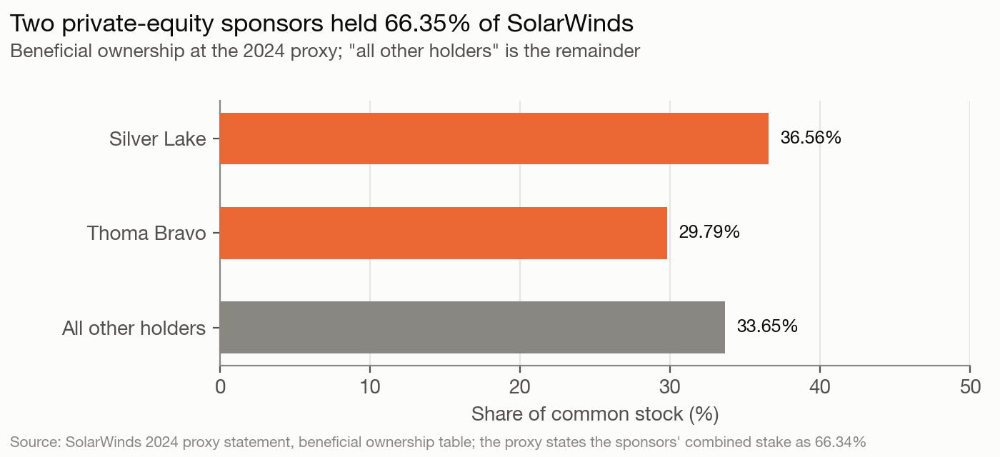
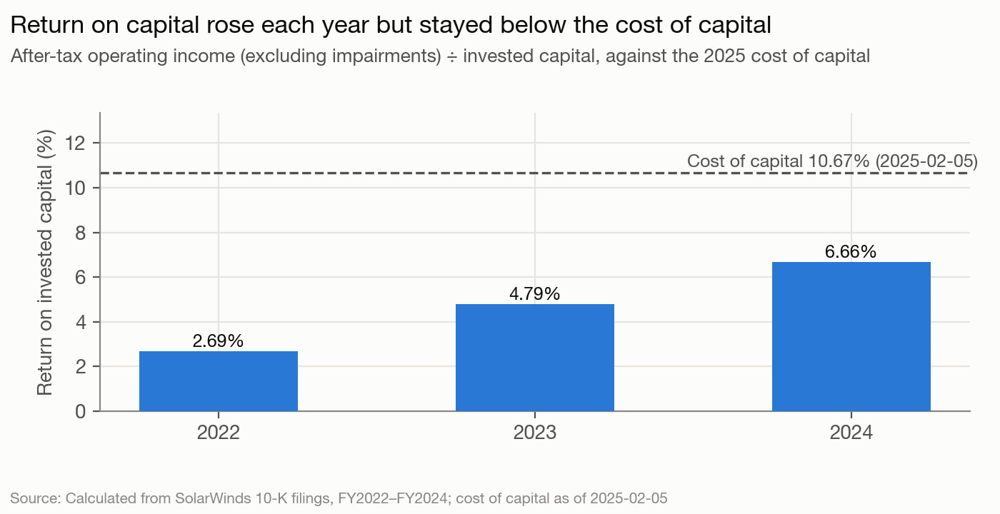
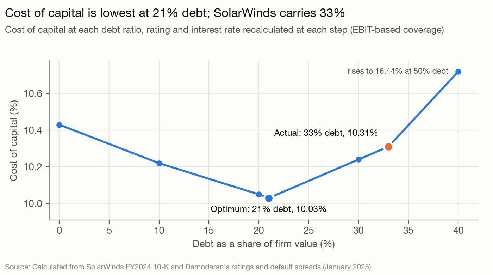
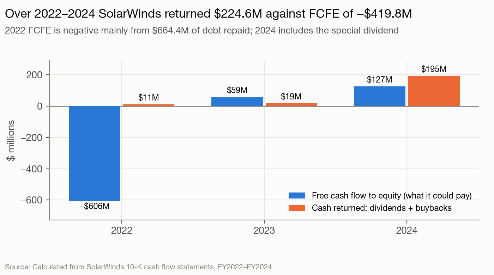
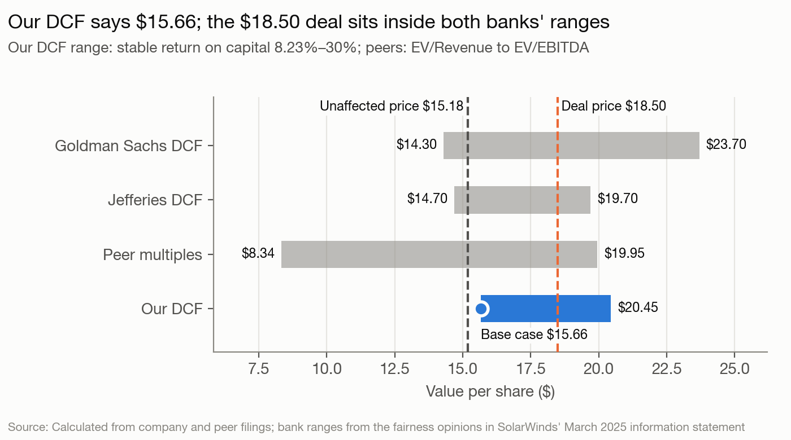

# SolarWinds (SWI) — Final Report Exhibits

Charts and tables for the final report, in the order of the course's nine project questions, as the example reports use them ([../../../../03-1-course-overview/final-project/report-format.md](../../../../03-1-course-overview/final-project/report-format.md)). All are generated by [make-exhibits.py](make-exhibits.py) from [model-output.md](../model-output.md) and the [ledger](../inputs.yaml); re-run it after any model change. The example reports lean on tables, so each chart below is one the grader would otherwise have to work out from a table.

## Question 1 — Who holds the power

## Question 2 — Risk and the hurdle rate

**Cost of capital, 2025-02-05**

| Item | Value | How |
|---|---|---|
| Risk-free rate | 4.43% | market.risk_free_rate (government bond rate − sovereign default spread) |
| Unlevered beta | 1.2200 | beta.unlevered_bottom_up |
| Levered beta | 1.6714 | unlevered × (1 + (1 − t) × D/E) |
| Equity risk premium | 4.92% | country.weighted_erp |
| Cost of equity | 12.65% | rf + levered beta × ERP |
| Pre-tax cost of debt | 8.85% | government bond rate plus the synthetic-rating spread (B-) |
| Marginal tax rate | 25.00% | market.tax_rate_marginal |
| After-tax cost of debt | 6.64% | pre-tax × (1 − t) |
| Debt ratio (D/V) | 33.03% | arithmetic |
| **Cost of capital (WACC)** | **10.67%** | E/V × ke + D/V × kd × (1 − t) |

## Question 3 — Investment returns

## Questions 4–6 — Financing mix, the optimum, and getting there

**Cost of capital schedule (EBIT-based coverage)**

| Debt ratio | Levered beta | Cost of equity | Coverage | Rating | Pre-tax cost of debt | WACC |
|---|---|---|---|---|---|---|
| 0% | 1.220 | 10.43% | n/a | AAA | 4.88% | 10.43% |
| 10% | 1.322 | 10.93% | 10.65x | AA | 5.03% | 10.22% |
| 20% | 1.449 | 11.56% | 4.98x | A- | 5.38% | 10.05% |
| 21% ← optimum | 1.463 | 11.63% | 4.74x | A- | 5.38% | 10.03% |
| 30% | 1.612 | 12.36% | 2.54x | B+ | 7.04% | 10.24% |
| 33% ← current | 1.671 | 12.65% | 2.19x | B | 7.43% | 10.31% |
| 40% | 1.830 | 13.43% | 1.51x | B- | 8.85% | 10.72% |
| 50% | 2.135 | 14.93% | 0.54x | C | 19.93% | 16.44% |

## Questions 7–8 — Dividend policy and assessment

**Free cash flow to equity against cash returned**

| Year | Net income | Net capex | Net new debt | FCFE | Cash returned | Returned − FCFE |
|---|---|---|---|---|---|---|
| 2022 | $-929.4M | $-74.2M | $-664.4M | $-606.2M | $11.1M | $617.3M |
| 2023 | $-9.1M | $-63.9M | $-9.3M | $59.4M | $18.8M | $-40.6M |
| 2024 | $111.9M | $-53.9M | $0.0M | $127.0M | $194.7M | $67.7M |
| **Total** |  |  |  | **$-419.8M** | **$224.6M** | **$644.4M** |

## Question 9 — Valuation

**DCF bridge**

| Bridge | Amount |
|---|---|
| Present value of explicit cash flows | $1,303.2M |
| Present value of terminal value | $2,596.7M |
| **Enterprise value** | **$3,899.8M** |
| − Debt | $1,285.0M |
| + Cash | $259.3M |
| = Equity value before option claims | $2,874.1M |
| − Value of options and RSUs | $187.0M |
| **Value per share (course method: ÷ basic shares 171.6M)** | **$15.66** |
| Market or transaction price (last-unaffected) | $15.18 |
| Deal price | $18.50 |

**Terminal-period cost of capital**

| Terminal-period cost of capital | Value | How |
|---|---|---|
| Stable beta | 1.00 | forecast.stable_beta (lesson 32: betas move toward one) |
| Stable cost of equity | 9.35% | rf 4.43% + stable beta × ERP 4.92% |
| Stable debt ratio | 21.00% | forecast.stable_debt_ratio |
| Pre-tax cost of debt | 5.38% | section 3 schedule at 21.00% debt: A- rating, 4.43% + spread |
| After-tax cost of debt | 4.04% | pre-tax × (1 − t) |
| **Stable cost of capital** | **8.23%** | (1 − D/V) × ke + D/V × kd × (1 − t) |

**Value per share by the return on new capital after 2030**

| Stable ROIC | Terminal reinvestment rate | Terminal value | Value per share |
|---|---|---|---|
| 8.23% (ledger) | 30.38% | $4,769.8M | $15.66 |
| 10.00% | 25.00% | $5,138.1M | $16.83 |
| 12.00% | 20.83% | $5,423.6M | $17.73 |
| 15.00% | 16.67% | $5,709.0M | $18.64 |
| 20.00% | 12.50% | $5,994.5M | $19.54 |
| 30.00% | 8.33% | $6,279.9M | $20.45 |

**Stress cases: revenue at the 2022–2024 growth rate instead of the plan**

| Case | Revenue growth | Margin | 2030 revenue | 2030 FCFF | Enterprise value | Value per share | vs. plan |
|---|---|---|---|---|---|---|---|
| Plan (management forecast) | 8.12% | plan | $1,273.0M | $419.0M | $3,899.8M | $15.66 |  |
| Revenue at the 2022–2024 rate, plan margins | 5.25% | plan | $1,083.3M | $345.3M | $3,383.0M | $12.65 | -3.01 |
| Revenue at the 2022–2024 rate, margin held at the plan's first year | 5.25% | 32.69% | $1,083.3M | $284.7M | $2,854.1M | $9.57 | -6.09 |
| Revenue at the 2022–2024 rate, margin held at 2024 on the plan's basis | 5.25% | 29.11% | $1,083.3M | $255.6M | $2,548.9M | $7.79 | -7.87 |

**Relative valuation**

| Multiple | SolarWinds Corporation | Peer median | Peers used |
|---|---|---|---|
| EV / Revenue | 4.56x | 3.32x | 8 |
| EV / EBITDA | 12.84x | 16.39x | 6 |
| Price / Earnings | 23.28x | 26.57x | 7 |
| Price / Book | 1.86x | 4.58x | 8 |
